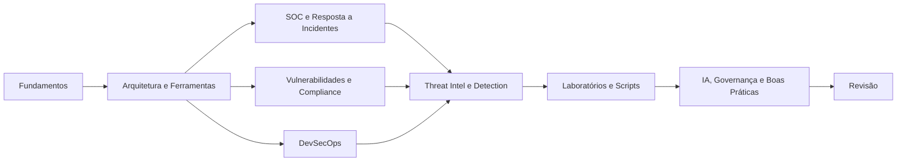

# MOC - Automação de Segurança

Bem-vindo ao vault de estudos sobre **automação de segurança**, com foco **defensivo e prático**, em português do Brasil. O material é voltado a estudantes e profissionais de nível intermediário a avançado e foi organizado para que o grafo do Obsidian reflita o encadeamento real do conhecimento: do porquê de automatizar até a governança do uso de IA.

> [!info] Onde fica este material
> Esta parte do material fica em `Ciberseguranca-Vault/03 - Automação de Segurança` do vault **Materiais-Obsidian** (veja o [[README]]).

> [!tip] Como começar
> Siga a trilha numerada abaixo ou use o [[MOC - Revisão - Automação]] para montar sua rotina de estudo.

## Mapa de conteúdo

| Pasta | MOC | Foco |
|---|---|---|
| 01 | [[MOC - Fundamentos - Automação]] | Por quê, o quê, maturidade, métricas e frameworks |
| 02 | [[MOC - Arquitetura e Ferramentas]] | SIEM, SOAR, EDR/XDR, CSPM, APIs, IaC e segredos |
| 03 | [[MOC - SOC e Resposta a Incidentes]] | Triagem, enriquecimento, playbooks e contenção |
| 04 | [[MOC - Vulnerabilidades e Compliance]] | Varredura, priorização, patching e compliance as code |
| 05 | [[MOC - DevSecOps]] | SAST, DAST, SCA, SBOM, OPA e pipelines |
| 06 | [[MOC - Threat Intel e Detecção]] | STIX/TAXII, MISP, Sigma, YARA e detection-as-code |
| 07 | [[MOC - Laboratórios e Scripts]] | Scripts defensivos e laboratório guiado |
| 08 | [[MOC - IA, Governança e Boas Práticas]] | LLMs, riscos, governança e LGPD |
| 09 | [[MOC - Revisão - Automação]] | Glossário, flashcards, exercícios e roteiro |

## Trilha de aprendizagem

## Templates

Para criar novas notas, utilize [[Template de Conceito - Automação]], [[Template de Playbook - Automação]], [[Template de Laboratório - Automação]] e [[Template de Flashcard - Automação]].

> [!warning] Escopo
> Todo o conteúdo é **defensivo e educacional**. Técnicas de ataque aparecem apenas em nível conceitual, com foco em detecção e resposta. Nunca aplique scripts ou testes em sistemas sem autorização formal.

## Para revisar

> [!question] Autoavaliação inicial
> 1. Quais tarefas de segurança do seu ambiente são repetitivas e bem definidas?
> 2. Qual métrica você usaria para provar o ganho de uma automação?
> 3. Onde um humano precisa permanecer no circuito de decisão?
