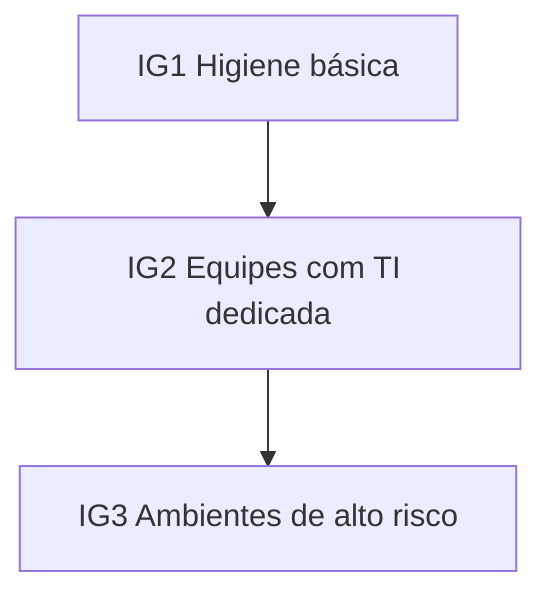

# Framework CIS Controls

## Objetivo
Conhecer os CIS Controls v8 como conjunto priorizado de medidas defensivas e identificar quais são mais facilmente automatizáveis. Mapa: [[MOC - Fundamentos - Automação]].

## Conceito
Os CIS Critical Security Controls são um conjunto de práticas priorizadas, derivadas de ataques reais, voltado a reduzir risco de forma pragmática. A versão 8 reúne 18 controles, divididos em **Grupos de Implementação** (IG1, IG2, IG3), que escalam conforme o porte e a maturidade da organização. O IG1 representa a "higiene básica" e deve ser o primeiro objetivo.

Controles de maior potencial de automação:

| Controle | Tema | Automação típica |
|---|---|---|
| 1 | Inventário de ativos corporativos | Descoberta contínua ([[Inventário de Ativos]]) |
| 2 | Inventário de software | Coleta de SBOM e listas ([[SBOM]]) |
| 3 | Proteção de dados | Classificação e criptografia |
| 4 | Configuração segura | Baseline e desvio ([[Hardening com CIS Benchmarks]]) |
| 5 e 6 | Contas e controle de acesso | Revisão de acessos, rotação |
| 7 | Gestão contínua de vulnerabilidades | [[Varredura Contínua de Vulnerabilidades]] |
| 8 | Gestão de logs de auditoria | Centralização no [[SIEM]] |
| 17 | Resposta a incidentes | [[Playbook de Phishing|Playbooks]] |

Os **CIS Benchmarks** são guias de configuração segura por tecnologia, distintos dos Controls, e podem ser verificados automaticamente.

## Exemplo prático
> [!example] Verificação do Controle 4
> Um job semanal executa um scanner de conformidade contra os servidores Linux, compara com o benchmark e publica o percentual de aderência no painel. Desvios geram tickets com o responsável do ativo. Veja [[Lab - Verificação de Hardening]] e [[Compliance as Code]].

## Boas práticas
- Comece pelo IG1, concentrando-se nos controles 1 e 2: o que não se conhece não se protege.
- Gere evidências automaticamente para [[Auditoria Contínua]].
- Relacione cada controle a uma métrica ([[Métricas - MTTD, MTTR, Falso Positivo e ROI]]).
- Combine com [[Framework NIST CSF]] para visão estratégica e [[Framework MITRE ATT&CK]] para detecção.

## Erros comuns
- Tentar implementar os 18 controles de uma vez.
- Inventário desatualizado, que invalida os demais controles.
- Confundir pontuação de conformidade com segurança efetiva.
- Aplicar benchmark sem testar o impacto em produção.

> [!tip] Ordem de ataque
> Inventário, configuração segura e gestão de vulnerabilidades rendem o maior ganho por esforço e são excelentes alvos de automação.

## Para revisar
> [!question] Perguntas
> 1. O que diferencia IG1, IG2 e IG3?
> 2. Por que os controles 1 e 2 vêm primeiro?
> 3. Qual a diferença entre CIS Controls e CIS Benchmarks?
> 4. Dê dois controles com alto potencial de automação.

## Links relacionados
[[Framework NIST CSF]], [[Framework MITRE ATT&CK]], [[Patch Management Automatizado]], [[Níveis de Maturidade da Automação]].
