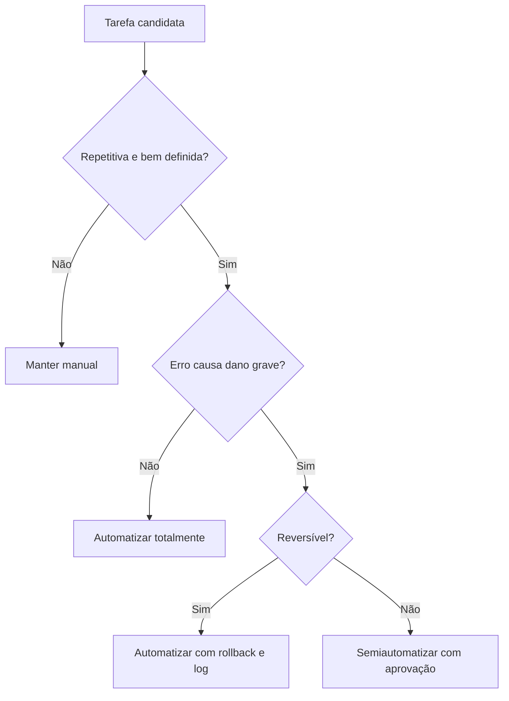

# O que Automatizar e o que Não Automatizar

## Objetivo
Aplicar critérios objetivos para decidir quais tarefas de segurança valem a automação e quais exigem julgamento humano. Mapa: [[MOC - Fundamentos - Automação]].

## Conceito
A decisão equilibra **frequência**, **previsibilidade**, **impacto de erro** e **reversibilidade**. Tarefas frequentes, determinísticas e de baixo impacto são candidatas ideais. Tarefas raras, ambíguas ou com consequências irreversíveis pedem humano no circuito ([[Human in the Loop - Automação]]).

| Critério | Favorece automação | Favorece decisão humana |
|---|---|---|
| Frequência | Alta, diária | Rara |
| Regras | Claras e determinísticas | Ambíguas, dependem de contexto |
| Impacto do erro | Baixo ou reversível | Alto ou irreversível |
| Dados | Estruturados, via API | Não estruturados, políticos |

**Bons candidatos:** enriquecimento de IOCs, deduplicação de alertas, abertura e rotulagem de casos, coleta de evidências, varredura contínua de vulnerabilidades, verificação de conformidade, rotação de credenciais, geração de relatórios.

**Candidatos a semiautomação (com aprovação):** isolamento de endpoint, desativação de conta, bloqueio de IP em borda, revogação de tokens de produção.

**Mantenha manual:** decisões de comunicação com clientes e reguladores, acionamento jurídico, resposta a incidentes inéditos, atribuição de autoria, desligamento de sistemas críticos de negócio.

## Exemplo prático
> [!example] Conta comprometida
> Detectado login impossível por viagem, o fluxo revoga sessões ativas (reversível) automaticamente, mas só desativa a conta de um diretor após aprovação do analista. Detalhes em [[Playbook de Conta Comprometida]] e [[Contenção Automatizada]].

## Boas práticas
- Classifique cada ação por nível de risco e defina quem aprova.
- Comece em modo "somente recomendar" e promova a ação automática após medir falsos positivos.
- Mantenha lista de exceções (VIPs, sistemas críticos) que nunca sofrem ação automática.
- Registre toda decisão na [[Trilha de Auditoria]].

## Erros comuns
- Automatizar pelo hype, sem caso de uso mensurável ([[Anti-Padrões de Automação de Segurança]]).
- Esquecer exceções e bloquear o CEO ou um servidor de produção.
- Tratar "automatizável" como sinônimo de "deve ser automatizado".

> [!tip] Regra prática
> Se você não consegue escrever o procedimento em passos objetivos, ainda não está pronto para automatizá-lo.

## Para revisar
> [!question] Perguntas
> 1. Quais quatro critérios guiam a decisão de automatizar?
> 2. Dê um exemplo de ação que deve exigir aprovação humana.
> 3. Por que a reversibilidade importa?
> 4. O que é modo "somente recomendar"?

## Links relacionados
[[Por que Automatizar Segurança]], [[Níveis de Maturidade da Automação]], [[Runbooks]], [[SOAR]].
