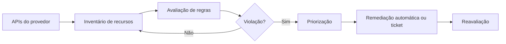

# CSPM

## Objetivo
Entender como o CSPM detecta e corrige configurações inseguras em nuvem, e como automatizar a remediação com salvaguardas. Mapa: [[MOC - Arquitetura e Ferramentas]].

## Conceito
O CSPM (Cloud Security Posture Management) avalia continuamente contas e assinaturas de nuvem em busca de **desvios de configuração**: buckets públicos, grupos de segurança abertos, chaves sem rotação, logs desativados, criptografia ausente. Ele compara o estado real com benchmarks (como o CIS Foundations, veja [[Hardening com CIS Benchmarks]]) e políticas internas.

Ciclo típico: **descobrir** recursos via API, **avaliar** contra regras, **priorizar** pelo risco e exposição, **remediar** e **verificar**. Diferenças em relação a outras ferramentas:

- Opera por APIs do provedor, sem agente.
- Foca em configuração, não em comportamento em tempo de execução (que é papel de EDR e de proteção de workload).
- Gera um inventário de recursos de nuvem, complementar ao [[Inventário de Ativos]].



A remediação ideal ocorre na origem: corrigir o código de [[Infrastructure as Code]] evita que o desvio retorne. A correção direta no console é aceitável como contenção, mas deve ser seguida de ajuste no código para impedir deriva (drift).

## Exemplo prático
> [!example] Bucket público
> O CSPM detecta bucket com acesso público e sem exceção cadastrada. O fluxo aplica o bloqueio de acesso público (reversível), abre um ticket para o dono do recurso e registra a ação. Se o bucket estiver em lista de exceções aprovadas, apenas notifica.

```python
def tratar_bucket_publico(bucket, excecoes):
    if bucket["nome"] in excecoes:
        return "notificar_dono"
    aplicar_bloqueio_publico(bucket["nome"])  # ação reversível
    abrir_ticket(bucket["dono"], bucket["nome"])
    return "remediado"
```

## Boas práticas
- Comece em modo detecção; ative remediação automática só para regras de baixo risco.
- Classifique achados por exposição à internet e sensibilidade dos dados.
- Gerencie exceções com prazo de validade e dono.
- Integre achados ao [[SOAR]] e à [[Gestão de Casos]].
- Use permissões mínimas para a conta do CSPM, preferencialmente somente leitura, com papel separado para remediação.

## Erros comuns
- Remediar automaticamente sem verificar dependências, quebrando aplicações.
- Ignorar deriva: corrigir no console e esquecer o código.
- Alarmes demais por regras genéricas, sem contexto de negócio.
- Cobertura parcial: contas ou regiões fora do escopo.

> [!warning] Remediação com privilégio
> O papel que corrige configurações é poderoso. Separe-o do papel de leitura e registre cada alteração na [[Trilha de Auditoria]].

## Para revisar
> [!question] Perguntas
> 1. O que o CSPM avalia e como obtém os dados?
> 2. Qual a diferença entre CSPM e EDR?
> 3. Por que corrigir o código IaC além do console?
> 4. Como tratar exceções de forma segura?

## Links relacionados
[[Infrastructure as Code]], [[Compliance as Code]], [[Políticas como Código com OPA]], [[Auditoria Contínua]], [[Framework CIS Controls]].
