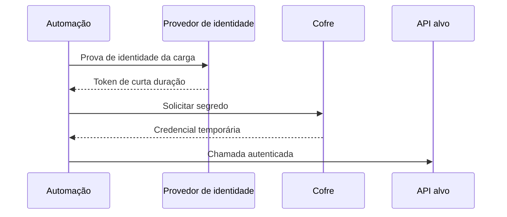

# Gestão de Segredos

## Objetivo
Armazenar, distribuir e rotacionar credenciais usadas pelas automações sem expô-las em código, logs ou variáveis inseguras. Mapa: [[MOC - Arquitetura e Ferramentas]].

## Conceito
Automações precisam de credenciais poderosas (tokens de [[EDR e XDR]], chaves de nuvem, contas de serviço). Se vazarem, o atacante herda o poder da automação. A **gestão de segredos** centraliza esse material em um cofre (como HashiCorp Vault, AWS Secrets Manager, Azure Key Vault ou Google Secret Manager), com controle de acesso, auditoria e rotação.

Princípios:

- **Nenhum segredo no código ou no Git.** Verifique com [[Secret Scanning]].
- **Menor privilégio:** cada automação acessa só os segredos de que precisa.
- **Segredos de vida curta:** prefira credenciais dinâmicas e tokens temporários a chaves estáticas.
- **Rotação automática:** troca periódica e imediata após suspeita de vazamento ([[Lab - Rotação de Credenciais]]).
- **Auditoria:** todo acesso ao cofre é registrado ([[Trilha de Auditoria]]).
- **Identidade de carga de trabalho:** autenticar a automação por identidade (papel, conta de serviço do orquestrador), e não por outro segredo guardado em arquivo.



## Exemplo prático
> [!example] Leitura segura em tempo de execução
> O script lê o segredo de uma variável injetada pelo orquestrador ou do cofre e jamais o imprime.

```python
import os

def obter_segredo(nome: str) -> str:
    valor = os.environ.get(nome)
    if not valor:
        raise RuntimeError(f"segredo {nome} ausente")
    return valor  # nunca registrar em log

token = obter_segredo("EDR_API_TOKEN")
```

Ao registrar eventos, mascare qualquer campo sensível antes de escrever em log.

## Boas práticas
- Separe segredos por ambiente (desenvolvimento, homologação, produção).
- Mantenha inventário de segredos com dono, escopo e data de rotação.
- Habilite alertas para uso anômalo de credenciais.
- Tenha procedimento de revogação de emergência testado ([[Rollback]]).
- Use gerenciamento de acesso com [[Segregação de Funções]] para quem administra o cofre.

## Erros comuns
- Segredo em variável de ambiente versionada, em imagem de contêiner ou em log.
- Chaves de longa duração sem rotação.
- Uma única credencial compartilhada por todas as automações.
- Cofre sem backup ou sem plano de recuperação.

> [!warning] Vazou? Revogue
> Remover o segredo do Git não basta: o histórico o preserva. Revogue e rotacione imediatamente.

## Para revisar
> [!question] Perguntas
> 1. Por que preferir credenciais de vida curta?
> 2. Como autenticar uma automação sem guardar outro segredo?
> 3. O que fazer quando um segredo vaza para o repositório?
> 4. Por que auditar o acesso ao cofre?
> 5. Qual o papel do secret scanning?

## Links relacionados
[[Infrastructure as Code]], [[Segurança em Pipelines CI-CD]], [[Orquestração via APIs]], [[Governança da Automação]].
