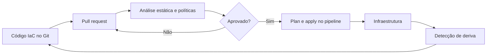

# Infrastructure as Code

## Objetivo
Aplicar IaC para provisionar e proteger infraestrutura de forma repetível, revisável e auditável, inclusive a própria infraestrutura de segurança. Mapa: [[MOC - Arquitetura e Ferramentas]].

## Conceito
Infrastructure as Code descreve recursos (redes, máquinas, funções, regras de firewall) em arquivos declarativos versionados, em vez de configuração manual. Ferramentas comuns incluem Terraform/OpenTofu, CloudFormation, Pulumi e Ansible (este também usado para configuração).

Benefícios para segurança:

- **Reprodutibilidade:** o mesmo código gera o mesmo ambiente, reduzindo configuração inconsistente.
- **Revisão por pares:** mudanças passam por pull request, com análise de segurança.
- **Auditoria:** o histórico do Git mostra quem mudou o quê e quando ([[Trilha de Auditoria]]).
- **Detecção de deriva:** comparar estado real e declarado revela alterações fora do processo.
- **Verificação prévia:** analisadores estáticos de IaC e [[Políticas como Código com OPA]] bloqueiam configurações inseguras antes da implantação ([[Shift Left]]).



A segurança também se beneficia ao usar IaC para implantar a própria stack defensiva: coletores de log, regras de detecção e papéis de acesso da automação, tudo versionado ([[Detection as Code]]).

## Exemplo prático
> [!example] Bucket seguro por padrão
> Um módulo reutilizável impõe criptografia e bloqueio de acesso público. Qualquer time que o use herda a configuração segura, e o pipeline reprova alterações que a removam.

```hcl
resource "aws_s3_bucket_public_access_block" "seguro" {
  bucket                  = aws_s3_bucket.dados.id
  block_public_acls       = true
  block_public_policy     = true
  ignore_public_acls      = true
  restrict_public_buckets = true
}
```

## Boas práticas
- Nunca armazene segredos no repositório; use o cofre ([[Gestão de Segredos]]).
- Proteja o estado remoto do IaC (criptografia, bloqueio e controle de acesso), pois pode conter dados sensíveis.
- Crie módulos padronizados com defaults seguros.
- Exija revisão e restrinja quem pode aplicar em produção ([[Segregação de Funções]]).
- Execute `plan` na revisão e `apply` apenas no pipeline.
- Alimente o [[CSPM]] com detecção de deriva.

## Erros comuns
- Alterações manuais no console que geram deriva silenciosa.
- Arquivo de estado em local sem proteção.
- Credenciais fixas no código ou em variáveis versionadas.
- Pipeline com permissão administrativa ampla.

> [!warning] Estado sensível
> O arquivo de estado pode conter senhas e chaves em texto claro. Trate-o como segredo.

## Para revisar
> [!question] Perguntas
> 1. Quais benefícios de segurança o IaC traz?
> 2. O que é deriva (drift) e como detectá-la?
> 3. Por que proteger o arquivo de estado?
> 4. Qual a vantagem de módulos com defaults seguros?

## Links relacionados
[[CSPM]], [[Compliance as Code]], [[Hardening com CIS Benchmarks]], [[Segurança em Pipelines CI-CD]].
