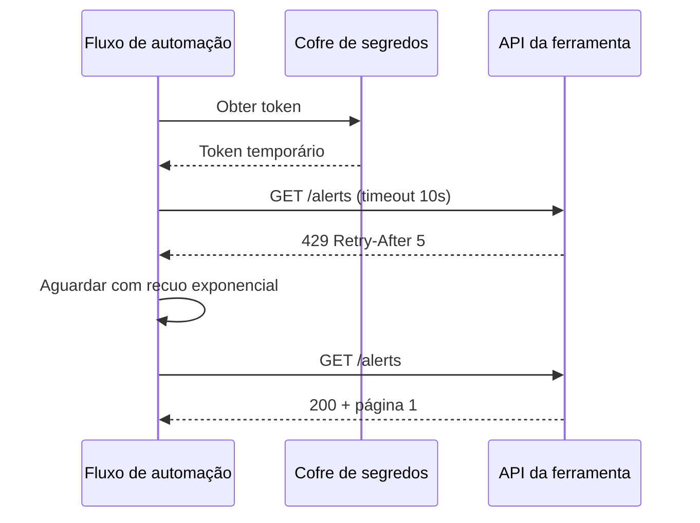

# Orquestração via APIs

## Objetivo
Dominar os princípios de integração por API REST aplicados à segurança: autenticação, paginação, limites de taxa, idempotência e tratamento de erros. Mapa: [[MOC - Arquitetura e Ferramentas]].

## Conceito
Quase toda automação de segurança é, no fundo, uma cadeia de chamadas de API: consultar um [[SIEM]], enriquecer um IOC, executar ação no [[EDR e XDR]], abrir ticket. A qualidade dessas chamadas determina a confiabilidade do conjunto.

Elementos essenciais:

- **Autenticação:** tokens de API, OAuth 2.0 (client credentials) ou certificados. Nunca embuta credenciais no código ([[Gestão de Segredos]]).
- **Paginação:** resultados grandes vêm em páginas; percorra até o fim.
- **Limite de taxa (rate limit):** respeite cabeçalhos como `Retry-After` e use recuo exponencial.
- **Idempotência:** repetir a chamada não deve duplicar efeitos (por exemplo, criar o mesmo bloqueio duas vezes).
- **Tempo limite e novas tentativas:** toda chamada precisa de timeout; erros transitórios justificam retry, erros de cliente (4xx) geralmente não.
- **Versionamento:** fixe a versão da API para evitar quebras.



## Exemplo prático
> [!example] Cliente resiliente
> Um cliente HTTP com timeout, retry com recuo e leitura do token a partir de variável de ambiente injetada pelo cofre.

```python
import os, time, requests

BASE = "https://api.exemplo.local/v1"

def get_com_retry(caminho, tentativas=4):
    token = os.environ["API_TOKEN"]  # injetado pelo cofre
    espera = 1
    for _ in range(tentativas):
        r = requests.get(f"{BASE}{caminho}",
                         headers={"Authorization": f"Bearer {token}"},
                         timeout=10)
        if r.status_code == 429:
            time.sleep(int(r.headers.get("Retry-After", espera)))
            espera *= 2
            continue
        r.raise_for_status()
        return r.json()
    raise RuntimeError("limite de tentativas excedido")
```

## Boas práticas
- Centralize clientes de API em uma biblioteca reutilizável com logs e métricas.
- Registre cada chamada de ação com identificador de correlação ([[Trilha de Auditoria]]).
- Use escopos mínimos nos tokens e prazos curtos.
- Valide e sanitize dados externos antes de usá-los em consultas ou comandos.
- Escreva testes com respostas simuladas (mocks).

## Erros comuns
- Ignorar paginação e analisar só a primeira página.
- Retry infinito, que agrava a indisponibilidade.
- Registrar tokens em logs.
- Confiar em campos da resposta sem validar o formato.

> [!warning] Dados não confiáveis
> Respostas de fontes externas podem conter conteúdo manipulado. Trate-as como entrada não confiável.

## Para revisar
> [!question] Perguntas
> 1. Por que respeitar o `Retry-After`?
> 2. O que é idempotência numa chamada de bloqueio?
> 3. Quando não se deve repetir uma requisição?
> 4. Onde guardar o token da API?
> 5. Por que fixar a versão da API?

## Links relacionados
[[Webhooks, Filas e Integrações]], [[Infrastructure as Code]], [[Lab - Enriquecimento de IOCs]], [[Enriquecimento de IOCs]].
