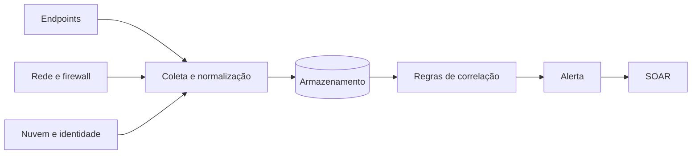

# SIEM

## Objetivo
Compreender o papel do SIEM como núcleo de coleta, correlação e alerta, e como integrá-lo à automação de segurança. Mapa: [[MOC - Arquitetura e Ferramentas]].

## Conceito
O SIEM (Security Information and Event Management) centraliza logs de fontes heterogêneas (endpoints, rede, nuvem, identidade, aplicações), normaliza-os, correlaciona eventos e gera alertas. É a principal fonte de gatilhos para fluxos de [[SOAR]].

Funções centrais:

- **Coleta e normalização:** agentes, syslog, APIs e coletores convertem logs para um esquema comum (por exemplo, ECS ou CIM).
- **Correlação:** regras que combinam eventos no tempo, como "cinco falhas de login seguidas de um sucesso".
- **Retenção e busca:** armazenamento para investigação e conformidade ([[Auditoria Contínua]]).
- **Alertas e painéis:** priorização visual e métricas ([[Métricas - MTTD, MTTR, Falso Positivo e ROI]]).



Para automação, o ponto-chave é a **API de busca e de alertas** e a capacidade de **enviar webhooks** a cada disparo ([[Webhooks, Filas e Integrações]]). Regras devem ser gerenciadas como código ([[Detection as Code]]) e escritas, sempre que possível, em formato portável como [[Regras Sigma - Automação]].

## Exemplo prático
> [!example] Alerta de força bruta com webhook
> A regra detecta muitas falhas de autenticação por usuário em 10 minutos. Ao disparar, o SIEM envia um webhook com usuário, origem e contagem. O fluxo enriquece o IP ([[Enriquecimento de IOCs]]) e abre um caso.

```yaml
rule: auth_bruteforce_followed_by_success
window: 10m
conditions:
  - event.outcome: failure
    count_by: user.name
    threshold: 5
  - event.outcome: success
    after: previous
actions:
  - webhook: soar-intake
```

## Boas práticas
- Garanta qualidade de log antes de criar regras: sincronização de horário e campos padronizados.
- Versione regras e teste-as ([[Testes de Detecção]]).
- Defina retenção por criticidade para controlar custo.
- Monitore a saúde da coleta; fonte silenciosa é ponto cego.
- Mapeie regras ao [[Framework MITRE ATT&CK]].

## Erros comuns
- Ingerir tudo sem critério, gerando custo e ruído.
- Regras sem dono nem revisão, que acumulam falsos positivos.
- Não alertar quando uma fonte para de enviar logs.
- Alertas sem contexto de ativo, o que dificulta a triagem.

> [!warning] Dados sensíveis
> Logs podem conter dados pessoais e segredos. Aplique mascaramento e controle de acesso ([[Aspectos Legais e LGPD]]).

## Para revisar
> [!question] Perguntas
> 1. Quais as quatro funções centrais de um SIEM?
> 2. Por que normalizar logs?
> 3. Como o SIEM aciona um fluxo no SOAR?
> 4. Por que monitorar fontes silenciosas?
> 5. Qual o benefício de escrever regras em formato portável?

## Links relacionados
[[SOAR]], [[EDR e XDR]], [[Comparativo de Ferramentas - Automação]], [[Triagem Automática de Alertas]], [[Regras Sigma - Automação]].
