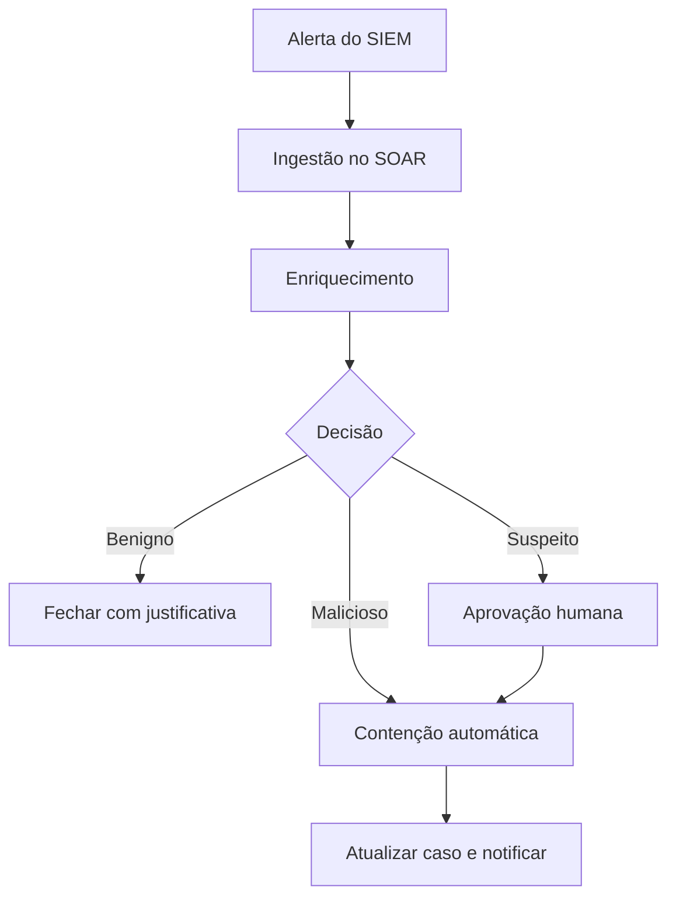

# SOAR

## Objetivo
Entender como plataformas SOAR orquestram ferramentas, executam playbooks e padronizam a resposta a incidentes. Mapa: [[MOC - Arquitetura e Ferramentas]].

## Conceito
SOAR (Security Orchestration, Automation and Response) conecta ferramentas de segurança por meio de integrações, executa **playbooks** (fluxos automatizados) e gerencia **casos**. Seus pilares:

- **Orquestração:** coordenar [[SIEM]], [[EDR e XDR]], firewall, identidade, e-mail e tickets via [[Orquestração via APIs]].
- **Automação:** executar tarefas sem intervenção, como enriquecimento, consulta e notificação.
- **Resposta:** aplicar ações de contenção, com aprovação quando necessário ([[Human in the Loop - Automação]]).
- **Gestão de casos:** registro, evidências e linha do tempo ([[Gestão de Casos]]).



Um playbook é uma máquina de estados com ações, condições e tratamento de erro. Em maturidade avançada, playbooks são armazenados como código, revisados e testados ([[Ciclo de Vida da Automação]]). Existem soluções comerciais e abertas ([[Comparativo de Ferramentas - Automação]]), e muitas equipes combinam um motor de fluxo genérico com scripts próprios.

## Exemplo prático
> [!example] Playbook resumido de phishing
> Gatilho: e-mail reportado. Passos: extrair URLs e anexos, consultar reputação, pesquisar mensagens idênticas na caixa de outros usuários, e, se malicioso, solicitar aprovação para remoção em massa. Detalhes em [[Playbook de Phishing]].

```yaml
playbook: phishing_triage
trigger: user_reported_email
steps:
  - extract_indicators
  - enrich: [url_reputation, file_hash]
  - search_similar_messages
  - decision:
      if: score >= 80
      then: request_approval(action=purge_messages)
      else: close_as_benign
  - update_case
```

## Boas práticas
- Um playbook, um objetivo; evite fluxos monolíticos.
- Trate erros e timeouts de cada integração; defina caminhos alternativos.
- Use contas de serviço com privilégio mínimo e segredos em cofre ([[Gestão de Segredos]]).
- Registre cada ação executada na [[Trilha de Auditoria]].
- Meça o tempo economizado por playbook.

## Erros comuns
- Implantar SOAR antes de documentar processos ([[Runbooks]]).
- Playbooks sem limite de taxa nem idempotência.
- Dependência excessiva de um fornecedor, sem exportar a lógica.
- Falta de testes após atualização de API de integração.

> [!tip] Comece pequeno
> Automatize primeiro o enriquecimento e a abertura de casos; a contenção vem depois, com aprovação.

## Para revisar
> [!question] Perguntas
> 1. Quais os quatro pilares de um SOAR?
> 2. O que é um playbook?
> 3. Por que tratar erros de integração?
> 4. Quando exigir aprovação humana?
> 5. Qual a diferença entre SOAR e SIEM?

## Links relacionados
[[Contenção Automatizada]], [[Webhooks, Filas e Integrações]], [[Níveis de Maturidade da Automação]], [[Governança da Automação]].
