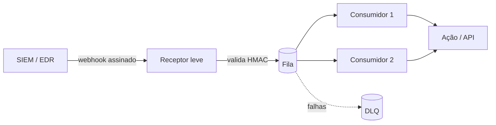

# Webhooks, Filas e Integrações

## Objetivo
Projetar integrações assíncronas e resilientes entre ferramentas de segurança usando webhooks e filas de mensagens. Mapa: [[MOC - Arquitetura e Ferramentas]].

## Conceito
Enquanto a [[Orquestração via APIs]] é baseada em requisição e resposta (pull), **webhooks** invertem o fluxo: a origem envia um evento (push) ao destino quando algo acontece. Isso reduz latência e consumo, ideal para alertas do [[SIEM]].

O risco do webhook direto é a perda de eventos se o receptor estiver indisponível ou sobrecarregado. A solução é desacoplar com **filas de mensagens**: o receptor apenas valida e enfileira, e **consumidores** processam no seu ritmo.

Conceitos-chave:

- **Validação de origem:** verificar assinatura HMAC do corpo da requisição, evitando eventos forjados.
- **Reconhecimento (ack):** o consumidor confirma só após processar com sucesso.
- **Fila de mensagens mortas (DLQ):** destino de eventos que falharam repetidamente, para análise.
- **Idempotência:** reprocessamento não pode duplicar ações; use um identificador de evento.
- **Contrapressão:** limitar a taxa de consumo para não derrubar sistemas a jusante.



## Exemplo prático
> [!example] Receptor com verificação de assinatura
> O receptor recusa qualquer requisição cuja assinatura não confira e só então publica na fila.

```python
import hmac, hashlib, os

def assinatura_valida(corpo: bytes, assinatura_recebida: str) -> bool:
    segredo = os.environ["WEBHOOK_SECRET"].encode()
    esperada = hmac.new(segredo, corpo, hashlib.sha256).hexdigest()
    return hmac.compare_digest(esperada, assinatura_recebida)
```

Use `compare_digest` para evitar ataques de temporização, e inclua carimbo de tempo no corpo assinado para rejeitar repetições antigas.

## Boas práticas
- Responda rápido (2xx) e processe de forma assíncrona.
- Aplique TLS e restrinja origem por lista de permissões quando possível.
- Monitore tamanho da fila, idade da mensagem mais antiga e volume da DLQ.
- Defina política de retentativa com recuo e limite.
- Mantenha esquema de evento versionado.
- Guarde o segredo do webhook no cofre ([[Gestão de Segredos]]).

## Erros comuns
- Endpoint de webhook público sem autenticação, aceitando eventos forjados.
- Processar sincronicamente e perder eventos em picos.
- Sem DLQ: mensagens problemáticas travam a fila.
- Não tratar duplicatas, causando ações repetidas ([[Contenção Automatizada]]).

> [!warning] Evento forjado
> Um atacante que consiga enviar eventos falsos pode induzir a automação a bloquear ativos legítimos. Verifique sempre a autenticidade.

## Para revisar
> [!question] Perguntas
> 1. Qual a diferença entre pull via API e push via webhook?
> 2. Para que serve a fila de mensagens mortas?
> 3. Como validar a autenticidade de um webhook?
> 4. Por que usar `compare_digest`?
> 5. O que é contrapressão?

## Links relacionados
[[SOAR]], [[Infrastructure as Code]], [[Runbooks]], [[Segurança em Pipelines CI-CD]].
