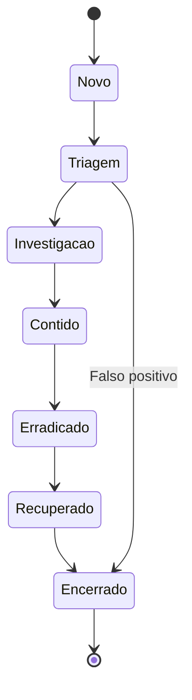

# Gestão de Casos

## Objetivo
Estruturar o registro de incidentes como fonte única de verdade, com automação de criação, atualização e métricas. Mapa: [[MOC - SOC e Resposta a Incidentes]].

## Conceito
A **gestão de casos** (case management) organiza cada incidente ou investigação em um registro que reúne alertas, evidências, ações, comunicações e decisões. É a memória do SOC e a base de auditoria, de lições aprendidas e de métricas ([[Métricas - MTTD, MTTR, Falso Positivo e ROI]]).

**Campos essenciais de um caso:**

- Identificador, título, severidade, prioridade e status.
- Origem (alerta, relato de usuário, inteligência).
- Ativos, usuários e indicadores envolvidos.
- Técnicas associadas do [[Framework MITRE ATT&CK]].
- Linha do tempo de ações, com autor (humano ou automação).
- Evidências com hash e cadeia de custódia.
- Classificação e causa raiz.
- Decisões e aprovações ([[Human in the Loop - Automação]]).

**Ciclo de status:** novo, em triagem, em investigação, contido, erradicado, recuperado, encerrado, com revisão pós-incidente.

**Automações valiosas:**

1. Criar o caso a partir do alerta, já enriquecido ([[Triagem Automática de Alertas]]).
2. Anexar automaticamente resultados de consultas e ações executadas.
3. Vincular alertas relacionados ao mesmo caso.
4. Aplicar prazos de SLA e alertar sobre atraso.
5. Gerar relatório final e itens de melhoria.



## Exemplo prático
> [!example] Registro automático de ação
> Cada ação do playbook acrescenta uma entrada padronizada ao caso, com autor, horário e resultado.

```python
from datetime import datetime, timezone

def registrar_acao(caso_id, acao, autor, resultado):
    entrada = {
        "caso": caso_id,
        "acao": acao,
        "autor": autor,  # usuário ou nome do playbook
        "resultado": resultado,
        "quando": datetime.now(timezone.utc).isoformat(),
    }
    adicionar_ao_caso(caso_id, entrada)
    return entrada
```

## Boas práticas
- Padronize taxonomia de tipos, severidades e causas raiz.
- Restrinja o acesso por sensibilidade, pois casos têm dados pessoais ([[Aspectos Legais e LGPD]]).
- Registre horários em UTC e de forma automática para métricas confiáveis.
- Faça revisão pós-incidente em casos relevantes e alimente [[Detection as Code]].
- Integre com o sistema de tickets da TI para tarefas de remediação.

## Erros comuns
- Documentação feita só no fim, de memória.
- Campos livres demais, impedindo análise agregada.
- Evidências anexadas sem hash nem origem.
- Casos encerrados sem causa raiz nem lição aprendida.

> [!tip] Fonte única
> Se a ação não está no caso, para fins de auditoria ela não aconteceu.

## Para revisar
> [!question] Perguntas
> 1. Quais informações todo caso deve conter?
> 2. Como a automação ajuda na documentação do caso?
> 3. Por que registrar horários automaticamente?
> 4. Qual a utilidade da revisão pós-incidente?

## Links relacionados
[[Runbooks]], [[Playbook de Phishing]], [[Playbook de Malware]], [[Rollback]], [[Governança da Automação]].
