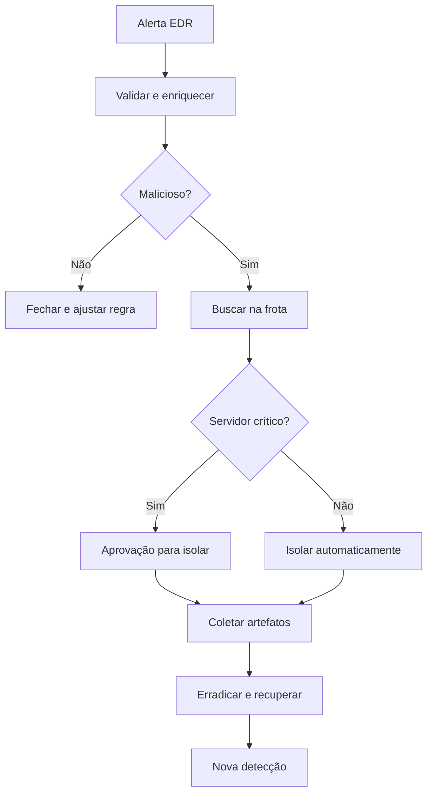

# Playbook de Malware

## Objetivo
Responder a detecções de código malicioso em endpoints com análise, contenção proporcional e verificação de propagação. Mapa: [[MOC - SOC e Resposta a Incidentes]].

## Conceito
O playbook de malware parte de um alerta do [[EDR e XDR]] ou antivírus e responde a quatro perguntas: **o que é**, **onde mais está**, **o que fez** e **como contê-lo**. O foco é defensivo: detectar, isolar, investigar e recuperar, sem análise ofensiva.

**Etapas:**

1. **Validação:** confirmar o alerta; descartar falso positivo conhecido (software legítimo com assinatura).
2. **Enriquecimento:** hash, caminho, processo pai e reputação ([[Enriquecimento de IOCs]]).
3. **Escopo:** pesquisar o mesmo hash, processo ou domínio de comando em toda a frota.
4. **Contenção:** quarentena do arquivo; isolamento do host conforme criticidade ([[Contenção Automatizada]]).
5. **Investigação:** coletar artefatos (lista de processos, conexões, persistência) para linha do tempo.
6. **Erradicação e recuperação:** remover persistência, reinstalar se necessário, restaurar e monitorar.
7. **Lições aprendidas:** criar ou ajustar detecção ([[Detection as Code]]).



## Exemplo prático
> [!example] Escopo por hash
> Após confirmar um binário malicioso em um host, o fluxo pesquisa o mesmo hash na telemetria dos últimos 30 dias. Encontra mais dois hosts, isola os dois e cria alerta para qualquer nova ocorrência.

```python
def escopo_por_hash(hash_sha256, consultar_telemetria):
    hosts = consultar_telemetria(hash=hash_sha256, dias=30)
    return sorted({h["hostname"] for h in hosts})
```

## Boas práticas
- Preserve evidências (cópia do artefato, memória quando aplicável) antes de apagar, respeitando a cadeia de custódia.
- Mantenha o canal de gerenciamento do agente durante o isolamento.
- Use ambiente de análise isolado e sem acesso à rede produtiva.
- Registre cada ação no caso ([[Gestão de Casos]]) e na [[Trilha de Auditoria]].
- Planeje a liberação do host após a erradicação ([[Rollback]]).

## Erros comuns
- Apagar o artefato sem coletar evidência.
- Isolar servidor crítico sem aprovação ([[Human in the Loop - Automação]]).
- Tratar só o host original e ignorar a propagação.
- Reinfecção por credenciais comprometidas não redefinidas ([[Playbook de Conta Comprometida]]).

> [!warning] Escopo defensivo
> O playbook não envolve executar ou modificar malware. Use análise estática por serviços e sandbox autorizados.

## Para revisar
> [!question] Perguntas
> 1. Quais as perguntas centrais do playbook?
> 2. Como determinar a extensão do incidente?
> 3. Por que preservar evidências antes da remoção?
> 4. Qual condição exige aprovação humana para isolar?

## Links relacionados
[[SOAR]], [[Playbook de Exfiltração de Dados]], [[Runbooks]], [[Framework MITRE ATT&CK]].
