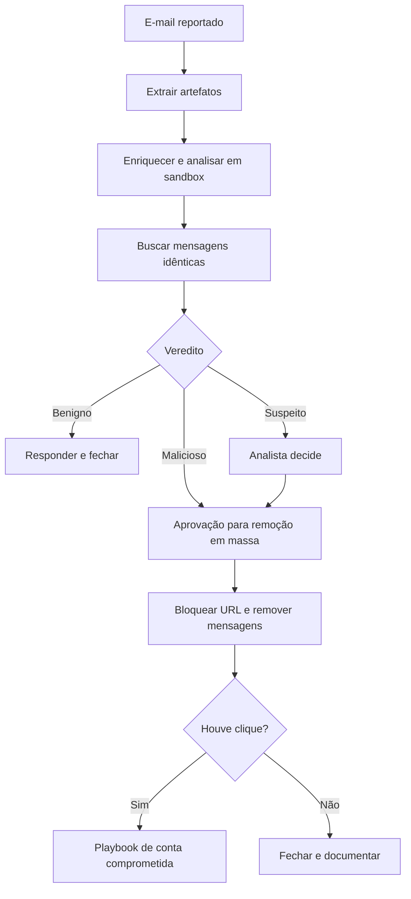

# Playbook de Phishing

## Objetivo
Automatizar a análise e a resposta a e-mails de phishing reportados ou detectados, com contenção proporcional ao risco. Mapa: [[MOC - SOC e Resposta a Incidentes]].

## Conceito
Phishing é o vetor de acesso inicial mais comum (técnica T1566 no [[Framework MITRE ATT&CK]]). O playbook cobre o ciclo: **recebimento, análise, decisão, contenção, erradicação e comunicação**.

**Gatilhos:** botão "reportar phishing", alerta do gateway de e-mail ou regra do [[SIEM]].

**Análise automática:**

- Extrair remetente, cabeçalhos (SPF, DKIM, DMARC), URLs e anexos.
- Enriquecer indicadores ([[Enriquecimento de IOCs]]).
- Analisar anexos em ambiente isolado (sandbox) e consultar reputação do hash.
- Buscar mensagens idênticas em outras caixas de correio.
- Verificar se alguém clicou ou abriu o anexo (logs de proxy e [[EDR e XDR]]).

**Decisão e contenção:**

- Malicioso: remover mensagens de todas as caixas, bloquear URL e domínio, redefinir credenciais de quem interagiu ([[Playbook de Conta Comprometida]]).
- Suspeito: pedir revisão do analista.
- Benigno: responder ao usuário e fechar.



## Exemplo prático
> [!example] Remoção em massa com aprovação
> O playbook encontra 37 mensagens idênticas e 2 cliques. Antes de purgar as caixas, solicita aprovação (ação ampla). Após aprovada, remove, bloqueia o domínio com TTL e abre sub-caso para os dois usuários que clicaram.

```yaml
playbook: phishing_response
approvals:
  purge_messages: required
  block_domain: automatic_if_confidence >= 0.8
on_click_detected: trigger(playbook_conta_comprometida)
notify: [usuario_reportante, soc]
```

## Boas práticas
- Sempre devolva feedback ao usuário que reportou; isso reforça a cultura de reporte.
- Preserve o e-mail original como evidência antes de remover ([[Gestão de Casos]]).
- Defina TTL para bloqueios e revise-os.
- Exclua da contenção remetentes internos legítimos e simulações de phishing autorizadas.
- Meça tempo de remoção e taxa de cliques ([[Métricas - MTTD, MTTR, Falso Positivo e ROI]]).

## Erros comuns
- Purgar mensagens legítimas por reputação instável.
- Não verificar cliques, deixando contas comprometidas passarem.
- Detonar anexos fora de ambiente isolado.
- Esquecer campanhas de treinamento autorizadas, tratando-as como ataque.

> [!tip] Campanhas internas
> Marque simulações de phishing autorizadas para que o playbook as reconheça e registre apenas o resultado.

## Para revisar
> [!question] Perguntas
> 1. Quais artefatos o playbook extrai do e-mail?
> 2. Por que pedir aprovação antes da remoção em massa?
> 3. O que fazer se houve clique no link?
> 4. Como evitar tratar simulações como ataques?

## Links relacionados
[[Runbooks]], [[SOAR]], [[Triagem Automática de Alertas]], [[Rollback]].
