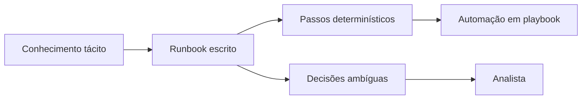

# Runbooks

## Objetivo
Escrever runbooks claros e executáveis, que sirvam tanto a analistas quanto de base para automação. Mapa: [[MOC - SOC e Resposta a Incidentes]].

## Conceito
Um **runbook** é um procedimento operacional passo a passo para uma situação específica. Um **playbook** (no sentido de [[SOAR]]) é o runbook transformado em fluxo executável. A relação é de evolução: primeiro o runbook documenta o conhecimento; depois, as etapas determinísticas viram automação, mantendo as decisões ambíguas para humanos ([[O que Automatizar e o que Não Automatizar]]).

**Estrutura recomendada:**

- **Gatilho:** quando usar.
- **Pré-requisitos:** acessos, ferramentas e dados necessários.
- **Passos numerados:** cada um com ação, comando ou consulta e resultado esperado.
- **Pontos de decisão:** critérios explícitos para ramificações.
- **Escalonamento:** quando e a quem acionar.
- **Verificação:** como confirmar que o passo funcionou.
- **Reversão:** como desfazer ([[Rollback]]).
- **Registro:** o que documentar no caso ([[Gestão de Casos]]).
- **Responsável e data de revisão.**



## Exemplo prático
> [!example] Runbook de bloqueio de IP
> Trecho de um runbook em formato Markdown executável por humanos e convertível em fluxo.

```markdown
## Runbook: Bloquear IP malicioso
Gatilho: alerta com IOC de reputação >= 80

1. Consultar o IP no cofre de inteligência. Esperado: veredito e fontes.
2. Verificar se o IP está na lista de exceções. Se sim, ESCALAR.
3. Aplicar bloqueio no firewall com TTL de 24h.
4. Verificar efeito: conexão bloqueada nos logs em 5 minutos.
5. Registrar no caso: IP, fonte, horário, responsável.
Reversão: remover regra pelo identificador registrado no passo 3.
```

## Boas práticas
- Escreva para quem está sob pressão: frases curtas, comandos copiáveis, resultados esperados.
- Teste o runbook com alguém que não o escreveu.
- Guarde-os versionados no Git, junto do código de automação.
- Revise após cada incidente e a cada semestre.
- Relacione cada runbook a técnicas do [[Framework MITRE ATT&CK]] e a detecções.

## Erros comuns
- Runbook genérico demais ("investigar o host").
- Sem critérios de decisão, dependendo de intuição.
- Documentos desatualizados em repositórios esquecidos.
- Omitir o passo de reversão.

> [!tip] Do runbook ao código
> Comece em texto. Só automatize o que já funciona bem manualmente ([[Ciclo de Vida da Automação]]).

## Para revisar
> [!question] Perguntas
> 1. Qual a diferença entre runbook e playbook?
> 2. Quais seções um bom runbook deve ter?
> 3. Por que testar com outra pessoa?
> 4. Por que incluir reversão e verificação?

## Links relacionados
[[Playbook de Phishing]], [[Human in the Loop - Automação]], [[Níveis de Maturidade da Automação]], [[Triagem Automática de Alertas]].
