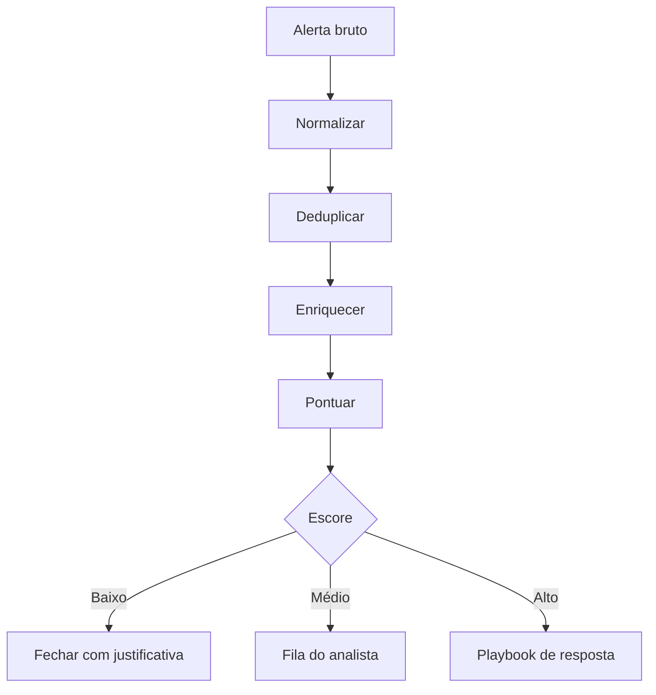

# Triagem Automática de Alertas

## Objetivo
Projetar um fluxo que receba alertas, remova ruído, adicione contexto e encaminhe ao destino correto, reduzindo o tempo de reconhecimento. Mapa: [[MOC - SOC e Resposta a Incidentes]].

## Conceito
A triagem decide, para cada alerta, se é **benigno**, **suspeito** ou **malicioso**, e qual a prioridade. Automatizá-la elimina o trabalho mecânico de coleta e deixa ao analista a análise. O fluxo típico tem cinco etapas:

1. **Normalização:** converter o alerta do [[SIEM]] ou [[EDR e XDR]] para um esquema comum.
2. **Deduplicação e agrupamento:** unir alertas repetidos do mesmo ativo ou usuário em uma janela de tempo.
3. **Enriquecimento:** reputação, contexto de ativo e identidade ([[Enriquecimento de IOCs]], [[Inventário de Ativos]]).
4. **Pontuação:** combinar fatores em um escore de risco.
5. **Roteamento:** fechar, escalar para humano ou acionar playbook específico.



O escore pode ser uma soma ponderada de sinais: severidade da regra, criticidade do ativo, reputação do indicador, histórico do usuário e técnica do [[Framework MITRE ATT&CK]]. É importante que seja **explicável**: o analista deve ver por que o alerta recebeu aquela nota.

## Exemplo prático
> [!example] Pontuação ponderada
> Um alerta em servidor crítico, com IP de reputação ruim e técnica de movimentação lateral recebe nota alta e aciona o playbook; o mesmo alerta em estação de teste vai para a fila.

```python
PESOS = {"severidade": 0.3, "criticidade_ativo": 0.3,
         "reputacao_ioc": 0.25, "historico_usuario": 0.15}

def escore(sinais: dict) -> float:
    return round(sum(PESOS[k] * sinais.get(k, 0) for k in PESOS), 1)

print(escore({"severidade": 7, "criticidade_ativo": 9,
              "reputacao_ioc": 8, "historico_usuario": 2}))  # 7.1
```

## Boas práticas
- Nunca feche automaticamente sem registrar a justificativa no caso ([[Gestão de Casos]]).
- Faça amostragem periódica de alertas fechados automaticamente para detectar falsos negativos.
- Ajuste pesos com base em feedback dos analistas.
- Acompanhe a taxa de falso positivo e o MTTA ([[Métricas - MTTD, MTTR, Falso Positivo e ROI]]).
- Mantenha lista de supressão com dono e validade.

## Erros comuns
- Suprimir ruído em vez de corrigir a regra de origem ([[Detection as Code]]).
- Escore opaco, que ninguém consegue auditar.
- Fechamento automático agressivo, que esconde ataques reais.
- Ignorar o contexto do ativo e tratar tudo como igual.

> [!warning] Falso negativo
> O pior erro da triagem é fechar um alerta verdadeiro. Priorize a amostragem de qualidade.

## Para revisar
> [!question] Perguntas
> 1. Quais são as cinco etapas da triagem automatizada?
> 2. Por que o escore precisa ser explicável?
> 3. Como detectar falsos negativos de fechamento automático?
> 4. Qual a diferença entre suprimir e corrigir a regra?

## Links relacionados
[[SOAR]], [[Human in the Loop - Automação]], [[Playbook de Phishing]], [[Runbooks]], [[Contenção Automatizada]].
