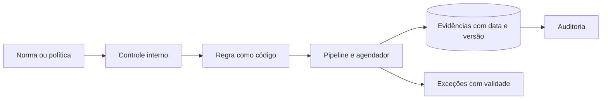

# Compliance as Code

## Objetivo
Traduzir requisitos normativos em verificações executáveis e versionadas, gerando evidências de conformidade de forma contínua. Mapa: [[MOC - Vulnerabilidades e Compliance]].

## Conceito
Em vez de checar conformidade em auditorias anuais com planilhas e capturas de tela, o **compliance as code** expressa cada requisito como uma regra testável automaticamente. A regra é código: versionada, revisada, testada e executada em pipeline ou em agenda.

**Cadeia de tradução:**

1. **Requisito:** texto de norma ou política (por exemplo, "criptografar dados em repouso").
2. **Controle:** declaração interna verificável ([[Framework CIS Controls]], [[Framework NIST CSF]]).
3. **Verificação:** regra em linguagem de política, consulta ou script.
4. **Evidência:** resultado com data, escopo e versão da regra.
5. **Exceção:** desvio aprovado, com validade.

**Onde as regras rodam:**

- **Antes da implantação:** análise de [[Infrastructure as Code]] com [[Políticas como Código com OPA]] (shift-left, veja [[Shift Left]]).
- **Em execução:** varredura de configuração em nuvem ([[CSPM]]) e em servidores ([[Hardening com CIS Benchmarks]]).
- **De forma periódica:** coleta de evidências para [[Auditoria Contínua]].



## Exemplo prático
> [!example] Regra e evidência
> Um requisito exige que todo volume de armazenamento seja criptografado. A regra percorre o inventário e gera evidência para cada recurso.

```python
def verificar_criptografia(recursos):
    evidencias = []
    for r in recursos:
        conforme = bool(r.get("criptografado"))
        evidencias.append({
            "recurso": r["id"],
            "controle": "ARM-01 criptografia em repouso",
            "conforme": conforme,
            "regra_versao": "1.2.0",
        })
    return evidencias
```

## Boas práticas
- Associe cada regra a um controle e a um requisito para rastreabilidade.
- Guarde evidências imutáveis e com carimbo de tempo.
- Teste as regras com casos conformes e não conformes.
- Trate exceções como dados, com dono, justificativa e vencimento.
- Revise as regras quando a norma ou o ambiente mudarem.

## Erros comuns
- Confundir conformidade com segurança: passar na checagem não prova proteção efetiva.
- Regras sem teste, que dão falsa sensação de conformidade.
- Evidência sem contexto (qual escopo, quando, qual versão).
- Excesso de regras sem prioridade, gerando fadiga de alerta.

> [!tip] Conformidade é efeito colateral
> Bons controles técnicos automatizados geram a conformidade como subproduto, e a auditoria passa a ser consulta, não projeto.

## Para revisar
> [!question] Perguntas
> 1. Como traduzir um requisito normativo em verificação executável?
> 2. Onde as regras de conformidade podem rodar?
> 3. Por que registrar versão da regra na evidência?
> 4. Por que conformidade não equivale a segurança?

## Links relacionados
[[Auditoria Contínua]], [[Trilha de Auditoria]], [[Aspectos Legais e LGPD]], [[Inventário de Ativos]].
