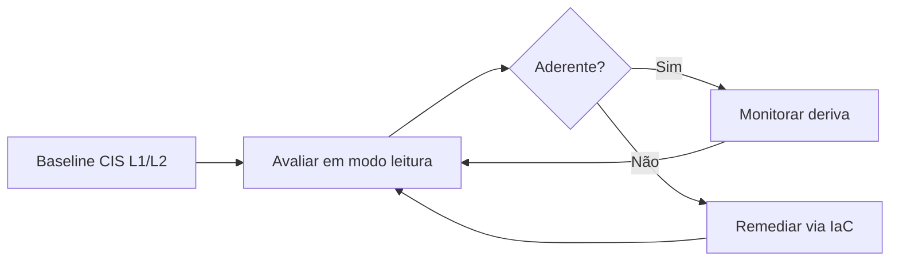

# Hardening com CIS Benchmarks

## Objetivo
Aplicar e verificar configurações seguras em sistemas operacionais, contêineres e serviços de forma automatizada e repetível. Mapa: [[MOC - Vulnerabilidades e Compliance]].

## Conceito
**Hardening** é reduzir a superfície de ataque removendo serviços desnecessários, restringindo permissões e ajustando configurações para um estado mais seguro. Os **CIS Benchmarks** são guias de configuração por tecnologia (Linux, Windows, nuvem, bancos de dados), elaborados por consenso, com recomendações numeradas e dois perfis de rigor: **Nível 1** (impacto baixo, aplicável quase sempre) e **Nível 2** (mais restritivo, para ambientes de maior risco).

**Fluxo automatizado:**

1. **Definir a baseline:** escolher benchmark e perfil, documentando desvios justificados.
2. **Avaliar:** executar ferramentas de verificação (como OpenSCAP, Lynis, scripts próprios) em modo somente leitura.
3. **Remediar:** aplicar correções via gestão de configuração (Ansible, Group Policy, imagens de base) ([[Infrastructure as Code]]).
4. **Verificar novamente:** confirmar a aderência.
5. **Monitorar deriva:** reavaliar periodicamente e alertar quando houver regressão.



**Estratégia recomendada:** aplicar o hardening na **imagem de base** (golden image) e na gestão de configuração, e não manualmente em cada servidor. Assim, novos sistemas já nascem endurecidos e a deriva é corrigida pelo código.

## Exemplo prático
> [!example] Verificação simples de parâmetros SSH
> Um script lê a configuração do serviço e compara com os valores esperados, reportando desvios. Veja o laboratório completo em [[Lab - Verificação de Hardening]].

```bash
#!/usr/bin/env bash
# Verificação somente leitura de parâmetros SSH
conf="/etc/ssh/sshd_config"
verificar() {
  chave="$1"; esperado="$2"
  atual=$(grep -Ei "^\s*${chave}\s" "$conf" | awk '{print tolower($2)}' | tail -1)
  [[ "$atual" == "$esperado" ]] && echo "OK    $chave=$atual" || echo "DESVIO $chave=${atual:-nao_definido} (esperado $esperado)"
}
verificar PermitRootLogin no
verificar PasswordAuthentication no
verificar X11Forwarding no
```

## Boas práticas
- Teste cada regra em homologação; algumas quebram aplicações.
- Documente exceções com justificativa e controle compensatório.
- Separe avaliação (leitura) de remediação (escrita), com aprovação para esta.
- Mantenha snapshot ou ponto de restauração antes de alterar ([[Rollback]]).
- Reporte aderência por grupo de ativos ([[Auditoria Contínua]]).

## Erros comuns
- Aplicar o Nível 2 inteiro em produção sem testes.
- Corrigir manualmente, gerando deriva e inconsistência.
- Benchmark desatualizado em relação à versão do sistema.
- Buscar 100% de aderência sem considerar necessidades do negócio.

> [!warning] Impacto operacional
> Algumas recomendações desativam funcionalidades usadas por aplicações. Valide antes de ampliar.

## Para revisar
> [!question] Perguntas
> 1. Qual a diferença entre CIS Controls e CIS Benchmarks?
> 2. O que distingue os perfis Nível 1 e Nível 2?
> 3. Por que endurecer a imagem de base?
> 4. Como lidar com recomendações que quebram aplicações?

## Links relacionados
[[Compliance as Code]], [[CSPM]], [[Inventário de Ativos]], [[Patch Management Automatizado]].
