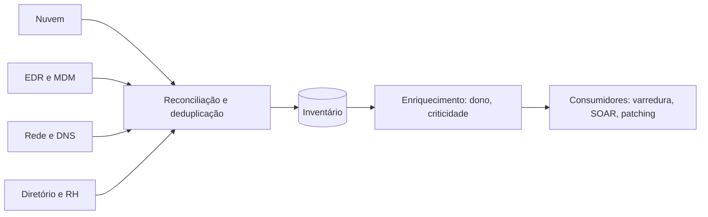

# Inventário de Ativos

## Objetivo
Manter um inventário automatizado, confiável e enriquecido de hardware, software, identidades e recursos de nuvem, base de todas as demais automações. Mapa: [[MOC - Vulnerabilidades e Compliance]].

## Conceito
Não se protege o que não se conhece. O inventário de ativos é o primeiro controle do [[Framework CIS Controls]] e alimenta [[Varredura Contínua de Vulnerabilidades]], priorização de vulnerabilidades, [[Triagem Automática de Alertas]] e contenção ([[Contenção Automatizada]]). Inventários manuais envelhecem em semanas; por isso a descoberta deve ser automática e contínua.

**Fontes de descoberta:**

- APIs de nuvem e orquestradores ([[CSPM]]).
- Agentes de [[EDR e XDR]] e gestão de dispositivos.
- Varreduras de rede, DHCP, DNS e tabelas ARP.
- Diretório de identidades e sistemas de RH.
- Repositórios de código e registros de contêineres ([[SBOM]]).

**Atributos úteis de cada ativo:**

| Atributo | Para que serve |
|---|---|
| Dono e equipe | Direcionar correções e aprovações |
| Criticidade | Priorizar vulnerabilidades e decidir ações automáticas |
| Exposição (internet, interna) | Compor risco |
| Classificação do dado | Avaliar impacto e obrigações legais |
| Software e versões | Casar com CVEs |
| Ambiente (prod, homolog) | Definir ondas de patch |

**Reconciliação:** várias fontes descrevem o mesmo ativo de maneiras diferentes. É preciso uma chave de identidade (por exemplo, combinação de identificador do provedor, serial e hostname) e regras de mesclagem.



## Exemplo prático
> [!example] Detectar ativos sem agente
> Compara a lista de ativos conhecidos com os que reportam ao EDR, apontando lacunas de cobertura.

```python
def sem_cobertura(inventario, hosts_com_agente):
    cobertos = {h.lower() for h in hosts_com_agente}
    return [a["hostname"] for a in inventario
            if a["hostname"].lower() not in cobertos
            and a["tipo"] in ("servidor", "estacao")]
```

## Boas práticas
- Defina o dono de cada ativo; ativo sem dono é risco.
- Detecte e alerte sobre ativos novos e desconhecidos (shadow IT).
- Meça a completude do inventário e a frescura dos dados.
- Exponha o inventário por API para outras automações ([[Orquestração via APIs]]).
- Trate o inventário como dado sensível, pois é um mapa do ambiente.

## Erros comuns
- Inventário em planilha atualizada manualmente.
- Fontes não reconciliadas, com duplicatas e conflitos.
- Esquecer ativos efêmeros (contêineres, funções, instâncias temporárias).
- Criticidade indefinida, tornando a priorização cega.

> [!tip] Primeiro controle
> Se a automação precisa de um único investimento prévio, que seja um inventário confiável.

## Para revisar
> [!question] Perguntas
> 1. Por que o inventário é o primeiro controle do CIS?
> 2. Quais fontes alimentam a descoberta automática?
> 3. Por que reconciliar fontes?
> 4. Quais atributos são essenciais para priorizar riscos?

## Links relacionados
[[Priorização com CVSS, EPSS e KEV]], [[Hardening com CIS Benchmarks]], [[Auditoria Contínua]], [[Gestão de Casos]].
