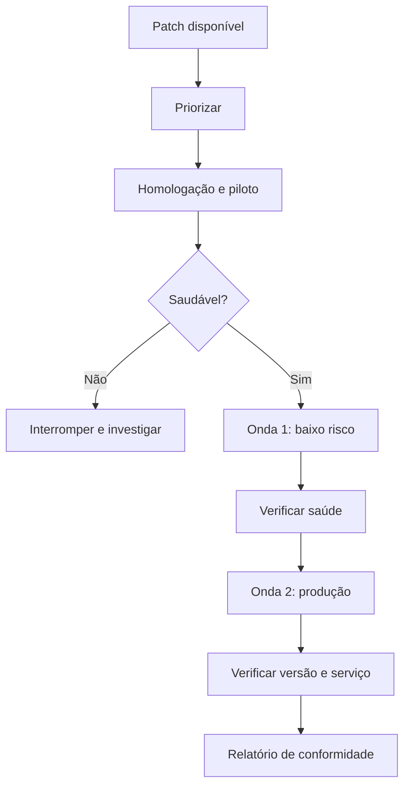

# Patch Management Automatizado

## Objetivo
Automatizar o ciclo de aplicação de correções, com testes, janelas controladas e plano de reversão, sem comprometer a disponibilidade. Mapa: [[MOC - Vulnerabilidades e Compliance]].

## Conceito
Aplicar patches é a forma mais eficaz de reduzir exposição, mas também fonte frequente de indisponibilidade. A automação busca velocidade com segurança, por meio de um processo em ondas.

**Etapas do ciclo:**

1. **Descobrir:** achados da [[Varredura Contínua de Vulnerabilidades]] e avisos de fornecedores.
2. **Priorizar:** ordem de risco ([[Priorização com CVSS, EPSS e KEV]]).
3. **Testar:** aplicar primeiro em ambiente de homologação ou grupo piloto.
4. **Implantar em ondas:** de ativos de baixo risco para os críticos, com pausa automática se houver falha.
5. **Verificar:** confirmar versão instalada e saúde do serviço.
6. **Reverter se necessário:** ([[Rollback]]).
7. **Reportar:** conformidade por grupo e por prazo.

**Estratégias complementares:**

- **Patch virtual ou controle compensatório:** regras de firewall de aplicação ou bloqueios temporários enquanto o patch não pode ser aplicado.
- **Imagens imutáveis:** em vez de corrigir máquinas, recriar a partir de imagem atualizada ([[Infrastructure as Code]]).
- **Janelas de manutenção** definidas por criticidade do serviço.
- **Exceções formais** para sistemas legados, com mitigação documentada.



## Exemplo prático
> [!example] Implantação em ondas com freio
> O fluxo aplica o patch em 10% do grupo, mede a taxa de falha e só prossegue se ficar abaixo do limite.

```python
def implantar_em_ondas(hosts, aplicar, saudavel, tamanho=0.1, limite_falha=0.05):
    inicio = 0
    passo = max(1, int(len(hosts) * tamanho))
    while inicio < len(hosts):
        onda = hosts[inicio:inicio + passo]
        falhas = sum(1 for h in onda if not (aplicar(h) and saudavel(h)))
        if falhas / len(onda) > limite_falha:
            return "interrompido"
        inicio += passo
    return "concluido"
```

## Boas práticas
- Tenha SLAs claros por prioridade e relate o cumprimento.
- Faça backup ou snapshot antes de mudanças em sistemas críticos.
- Evite aplicar tudo simultaneamente; escalone por ondas.
- Documente exceções com data de expiração.
- Alinhe o processo ao gerenciamento de mudanças ([[Governança da Automação]]).

## Erros comuns
- Patch direto em produção sem piloto.
- Sem verificação posterior: o patch "aplicou", mas o serviço quebrou ou a versão não mudou.
- Ignorar dependências e reinícios necessários.
- Exceções eternas para sistemas legados.

> [!warning] Disponibilidade
> Um patch automático mal testado pode causar mais dano que a vulnerabilidade. Use ondas e critérios de parada.

## Para revisar
> [!question] Perguntas
> 1. Por que implantar em ondas?
> 2. O que é patch virtual?
> 3. Que verificações fazer após a aplicação?
> 4. Como tratar sistemas legados que não podem ser corrigidos?

## Links relacionados
[[Hardening com CIS Benchmarks]], [[Auditoria Contínua]], [[Gestão de Casos]], [[Framework CIS Controls]].
