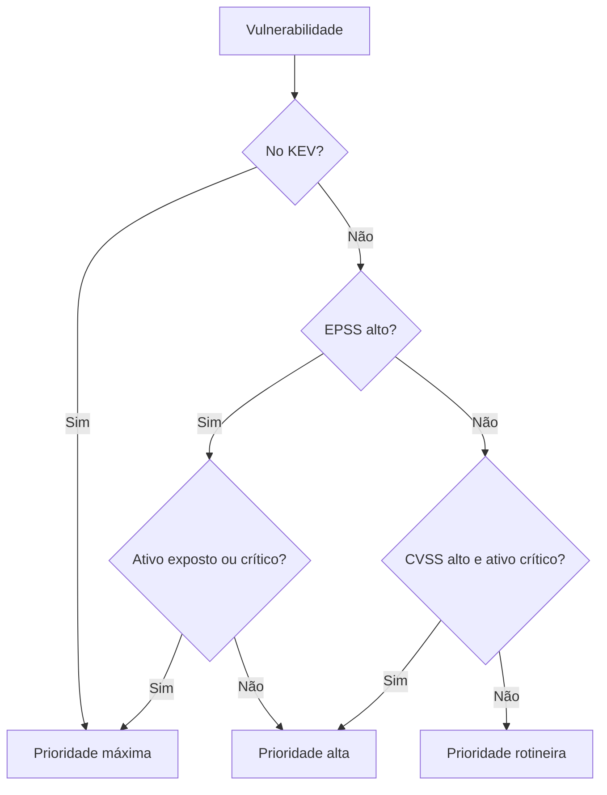

# Priorização com CVSS, EPSS e KEV

## Objetivo
Ordenar vulnerabilidades por risco real, combinando severidade técnica, probabilidade de exploração e contexto do ativo. Mapa: [[MOC - Vulnerabilidades e Compliance]].

## Conceito
Organizações encontram mais falhas do que conseguem corrigir. Priorizar apenas pela severidade leva a corrigir muita coisa de pouco risco. Três fontes se complementam:

- **CVSS (Common Vulnerability Scoring System):** mede a **severidade técnica** de 0 a 10, considerando vetor, complexidade, privilégios e impacto. Não mede probabilidade nem contexto. A pontuação base é fixa; as métricas ambientais permitem ajustá-la.
- **EPSS (Exploit Prediction Scoring System):** estima a **probabilidade** (0 a 1) de exploração observada nos próximos 30 dias, com base em dados reais. É atualizado diariamente.
- **KEV (Known Exploited Vulnerabilities):** catálogo da CISA com falhas **comprovadamente exploradas** na prática. Estar no KEV é um forte indicador para correção imediata.

Fatores de **contexto interno** completam a decisão: exposição à internet, criticidade do ativo e do dado, existência de controles compensatórios e disponibilidade de patch ([[Inventário de Ativos]]).



## Exemplo prático
> [!example] Função de prioridade
> Regras simples e explicáveis combinam as fontes e definem prazos de correção (SLA).

```python
def prioridade(cvss, epss, no_kev, exposto, ativo_critico):
    if no_kev:
        return ("P1", "7 dias")
    if epss >= 0.5 and (exposto or ativo_critico):
        return ("P1", "7 dias")
    if cvss >= 9 and ativo_critico:
        return ("P2", "15 dias")
    if epss >= 0.1 or (cvss >= 7 and exposto):
        return ("P2", "30 dias")
    return ("P3", "90 dias")
```

Os limiares são ilustrativos; ajuste-os ao seu apetite de risco. Um painel que compare a fila ordenada por CVSS com a ordenada por este critério costuma mostrar quanto esforço é poupado.

## Boas práticas
- Atualize EPSS e KEV automaticamente e reprocese a fila diariamente.
- Mantenha regras transparentes para auditoria e para negociar prazos.
- Defina SLAs por prioridade e meça o cumprimento ([[Métricas - MTTD, MTTR, Falso Positivo e ROI]]).
- Registre exceções com justificativa, controle compensatório e data de revisão.
- Encaminhe os itens P1 ao [[Patch Management Automatizado]].

## Erros comuns
- Usar só o CVSS base como prioridade.
- Ignorar exposição: falha crítica em sistema isolado difere de falha moderada em borda exposta.
- Tratar o EPSS como certeza, e não como probabilidade.
- Não reavaliar quando uma falha entra no KEV.

> [!tip] Combinação
> KEV responde "já está sendo explorada?", EPSS "provavelmente será?" e CVSS "o quanto dói se for?".

## Para revisar
> [!question] Perguntas
> 1. O que o CVSS mede e o que ele não mede?
> 2. Qual a diferença entre EPSS e KEV?
> 3. Que fatores de contexto interno alteram a prioridade?
> 4. Por que manter regras explicáveis?
> 5. Como tratar exceções?

## Links relacionados
[[Varredura Contínua de Vulnerabilidades]], [[Auditoria Contínua]], [[SCA]], [[Framework CIS Controls]], [[Compliance as Code]].
