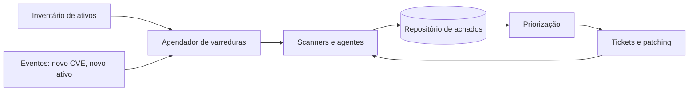

# Varredura Contínua de Vulnerabilidades

## Objetivo
Substituir varreduras pontuais e periódicas por um processo contínuo, autenticado e integrado ao inventário e à remediação. Mapa: [[MOC - Vulnerabilidades e Compliance]].

## Conceito
Varreduras trimestrais deixam janelas longas de exposição: uma falha divulgada hoje pode ser explorada semanas antes do próximo ciclo. A **varredura contínua** mantém visibilidade quase em tempo real combinando várias fontes:

- **Scanners de rede** (autenticados e não autenticados) contra faixas de IP.
- **Agentes** instalados nos hosts, que reportam software e configuração mesmo fora da rede corporativa.
- **Varredura de imagens e de dependências** no pipeline ([[SCA]], [[Scan de Containers]]).
- **Avaliação de nuvem** ([[CSPM]]).
- **Gatilhos por evento:** nova falha divulgada, novo ativo descoberto, mudança de configuração.

Pontos de atenção:

- **Escopo baseado no inventário:** o que não está em [[Inventário de Ativos]] não é escaneado.
- **Varredura autenticada:** reduz falsos positivos e encontra mais falhas, mas exige credenciais com privilégio mínimo e bem guardadas ([[Gestão de Segredos]]).
- **Janelas e impacto:** alguns ativos sensíveis exigem horários e intensidade controlados.
- **Autorização:** só escaneie ativos sob sua responsabilidade e com aprovação formal.



## Exemplo prático
> [!example] Reavaliação orientada a evento
> Ao ser publicado um novo CVE crítico, o fluxo consulta o inventário de software (sem varrer a rede inteira), lista os ativos afetados e só então dispara varredura direcionada neles, reduzindo carga e tempo.

```python
def ativos_afetados(cve_pacote, versao_vulneravel, inventario):
    return [a["host"] for a in inventario
            if cve_pacote in a["software"]
            and a["software"][cve_pacote] == versao_vulneravel]
```

## Boas práticas
- Alimente o escopo automaticamente a partir do inventário e da nuvem.
- Normalize e deduplique achados de várias ferramentas.
- Meça cobertura: percentual de ativos escaneados nos últimos N dias.
- Acompanhe tempo de correção por severidade ([[Métricas - MTTD, MTTR, Falso Positivo e ROI]]).
- Use a [[Priorização com CVSS, EPSS e KEV]] para ordenar, não apenas a severidade bruta.

## Erros comuns
- Escanear apenas o que é fácil, deixando ativos sem cobertura.
- Resultados sem dono, que ninguém corrige.
- Varredura agressiva derrubando sistemas frágeis.
- Contar achados em vez de reduzir risco.

> [!warning] Autorização
> Varredura sem autorização pode violar políticas e leis. Mantenha escopo e aprovação documentados.

## Para revisar
> [!question] Perguntas
> 1. Por que varreduras trimestrais são insuficientes?
> 2. Quais as vantagens da varredura autenticada?
> 3. Como o inventário influencia a cobertura?
> 4. O que significa varredura orientada a evento?

## Links relacionados
[[Patch Management Automatizado]], [[Auditoria Contínua]], [[Hardening com CIS Benchmarks]], [[Framework CIS Controls]].
