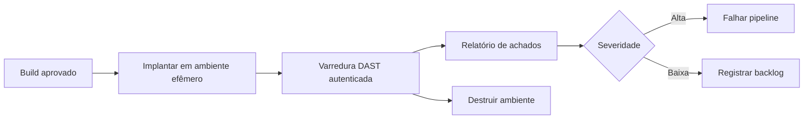

# DAST

## Objetivo
Executar testes dinâmicos automatizados contra aplicações em execução, em ambiente autorizado, para encontrar falhas visíveis em tempo de execução. Mapa: [[MOC - DevSecOps]].

## Conceito
O **DAST** (Dynamic Application Security Testing) avalia a aplicação **em funcionamento**, de fora para dentro, enviando requisições e analisando respostas, como faria um cliente. Complementa o [[SAST]]: encontra problemas de configuração, cabeçalhos ausentes, falhas de autenticação e sessão, exposição de informações e comportamento incorreto que o código isolado não revela.

**Características:**

- Independe da linguagem e do framework.
- Requer aplicação implantada (homologação ou ambiente efêmero).
- Resultados costumam apontar a URL e o parâmetro, não a linha de código.
- Mais lento que o SAST; por isso roda em etapas posteriores do pipeline ou em agenda.

**Modos de execução:**

- **Varredura de linha de base (passiva):** observa respostas sem ataques ativos, rápida e segura para pipeline.
- **Varredura ativa:** envia entradas de teste; deve ocorrer só em ambiente autorizado e isolado, pois pode alterar dados.
- **Autenticada:** usa credenciais de teste para alcançar áreas internas.



## Exemplo prático
> [!example] Varredura de linha de base no pipeline
> Após implantar um ambiente de teste efêmero, o job executa a varredura passiva e publica o relatório.

```yaml
dast:
  stage: test
  script:
    - docker run --rm -v "$PWD:/zap/wrk" zaproxy/zap-stable \
        zap-baseline.py -t "$URL_AMBIENTE_TESTE" -r relatorio.html
  artifacts:
    paths: [relatorio.html]
```

O alvo deve ser **exclusivamente** o ambiente de teste da própria organização.

## Boas práticas
- Use dados e contas de teste, nunca de produção.
- Isole o ambiente e defina escopo explícito de URLs.
- Execute varredura rápida a cada mudança e varredura profunda em agenda semanal ou noturna.
- Combine com [[SAST]] e [[SCA]] para cobertura em camadas.
- Documente autorização de teste e janelas.

## Erros comuns
- Rodar varredura ativa contra produção sem planejamento.
- Cobertura baixa por falta de autenticação ou de mapeamento de rotas.
- Alertas sem correlação com o código responsável.
- Ignorar APIs: forneça a especificação (OpenAPI) ao scanner.

> [!warning] Autorização
> Teste dinâmico só em sistemas próprios ou formalmente autorizados. Nunca aponte o scanner para terceiros.

## Para revisar
> [!question] Perguntas
> 1. Que classes de falha o DAST encontra melhor que o SAST?
> 2. Por que usar ambiente efêmero?
> 3. Diferencie varredura passiva e ativa.
> 4. Qual a vantagem de fornecer a especificação OpenAPI?

## Links relacionados
[[Shift Left]], [[Scan de Containers]], [[Políticas como Código com OPA]], [[Varredura Contínua de Vulnerabilidades]].
