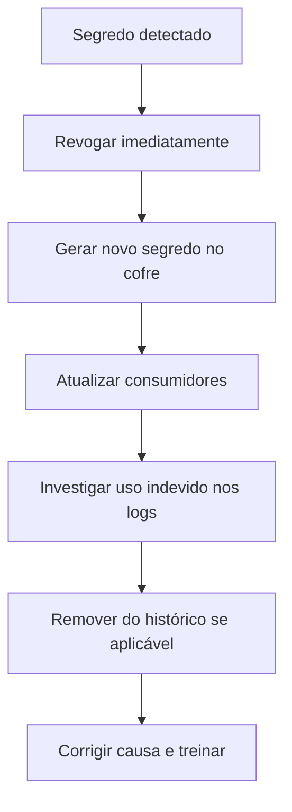

# Secret Scanning

## Objetivo
Detectar e tratar credenciais expostas em repositórios, histórico, imagens e logs, antes e depois do commit. Mapa: [[MOC - DevSecOps]].

## Conceito
Chaves de API, tokens, senhas e certificados privados em repositórios são uma das causas mais comuns de comprometimento. O **secret scanning** procura esses padrões automaticamente. Atua em três momentos:

1. **Pré-commit (local):** hook que impede o commit contendo segredo; é a barreira mais barata ([[Shift Left]]).
2. **No servidor (push protection) e no CI:** bloqueia ou alerta na entrada do código.
3. **Varredura de histórico e de outros alvos:** repositórios antigos, imagens de contêiner ([[Scan de Containers]]), artefatos e logs.

**Técnicas de detecção:**

- **Expressões regulares** para formatos conhecidos (prefixos e comprimentos característicos de tokens).
- **Entropia:** sequências aleatórias longas sugerem segredo.
- **Validação ativa:** testar se o segredo ainda é válido junto ao emissor, priorizando os ativos (feito apenas pela organização dona e com cuidado).

**Resposta a um vazamento:** o passo essencial é **revogar e rotacionar**, e não apenas apagar o arquivo, pois o histórico do Git preserva o valor. Depois, investigar uso indevido nos logs do provedor e corrigir a causa (como o segredo foi parar ali).



## Exemplo prático
> [!example] Hook de pré-commit e job de CI
> Configuração que bloqueia commits com segredos e varre o histórico no pipeline.

```yaml
# .pre-commit-config.yaml
repos:
  - repo: https://github.com/gitleaks/gitleaks
    rev: v8.18.4
    hooks:
      - id: gitleaks
```

```bash
# No CI: varrer o repositório inteiro, incluindo histórico
gitleaks detect --source . --redact --exit-code 1
```

A opção `--redact` evita que o valor do segredo apareça nos logs do pipeline.

## Boas práticas
- Habilite a proteção de push do provedor de repositório.
- Mascare segredos nos logs de CI.
- Mantenha lista de falsos positivos (valores de exemplo) com revisão.
- Use o cofre ([[Gestão de Segredos]]) para que os desenvolvedores não precisem de segredos locais.
- Meça o tempo entre detecção e revogação ([[Métricas - MTTD, MTTR, Falso Positivo e ROI]]).

## Erros comuns
- Apagar o segredo e não revogá-lo.
- Varrer só o estado atual, ignorando o histórico.
- Imprimir o segredo encontrado no relatório.
- Ignorar segredos em wikis, tickets, imagens e coleções de testes.

> [!warning] Considere vazado
> Todo segredo que esteve em repositório compartilhado deve ser tratado como comprometido, mesmo se removido em seguida.

## Para revisar
> [!question] Perguntas
> 1. Em que momentos o secret scanning atua?
> 2. Por que apagar o arquivo não resolve?
> 3. O que a entropia ajuda a detectar?
> 4. Qual o primeiro passo ao encontrar um segredo exposto?

## Links relacionados
[[SAST]], [[Lab - Rotação de Credenciais]], [[Infrastructure as Code]], [[Trilha de Auditoria]].
