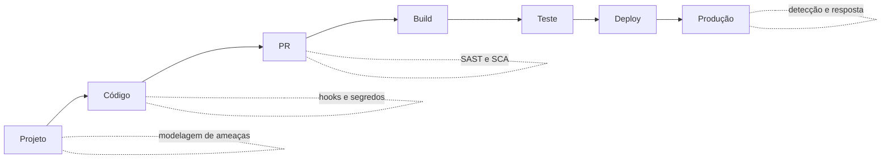

# Shift Left

## Objetivo
Entender o princípio de antecipar atividades de segurança para as fases iniciais do desenvolvimento, e aplicá-lo sem criar atrito excessivo. Mapa: [[MOC - DevSecOps]].

## Conceito
**Shift left** significa mover verificações de segurança para a esquerda da linha do tempo do desenvolvimento (projeto, código, build), em vez de concentrá-las no final (testes pré-lançamento) ou em produção. A lógica é econômica e técnica: quanto mais cedo uma falha é encontrada, mais barata e rápida é a correção, e menos contexto o desenvolvedor perde.

**Atividades por fase:**

| Fase | Controles | Notas |
|---|---|---|
| Projeto | Modelagem de ameaças, requisitos de segurança | Decisões de arquitetura |
| Codificação | Hooks de pré-commit, IDE, [[Secret Scanning]] | Feedback em segundos |
| Pull request | [[SAST]], [[SCA]], revisão de código | Foco no delta |
| Build | [[Scan de Containers]], [[SBOM]], assinatura | Artefato verificado |
| Teste | [[DAST]], testes de segurança automatizados | Ambiente efêmero |
| Implantação | [[Políticas como Código com OPA]], aprovação | Portões de segurança |
| Produção | Monitoramento, [[Varredura Contínua de Vulnerabilidades]] | Shift-left não elimina a direita |

**Shift left não é "jogar a responsabilidade ao desenvolvedor".** Requer ferramentas rápidas, resultados acionáveis, padrões seguros por padrão (templates, bibliotecas aprovadas) e apoio de uma equipe de segurança que atue como habilitadora (modelo de "Security Champions").



## Exemplo prático
> [!example] Caminho pavimentado
> Em vez de exigir que cada time configure segurança, a organização publica um modelo de repositório com pipeline pré-configurado (SAST, SCA, segredos, imagem), de modo que um novo serviço nasce já protegido. O custo de adoção para o time é praticamente zero.

```yaml
# template-servico/.github/workflows/seguranca.yml (trecho)
jobs:
  seguranca:
    uses: org/plataforma/.github/workflows/seguranca-padrao.yml@v3
```

## Boas práticas
- Priorize velocidade de feedback: verificações pesadas ficam fora do caminho crítico do commit.
- Comece pelo que é de alto sinal: segredos, dependências críticas, regras de alta confiança.
- Meça fricção (tempo de pipeline, falsos positivos) e adoção ([[Métricas - MTTD, MTTR, Falso Positivo e ROI]]).
- Forneça orientação de correção com cada achado.
- Mantenha controles à direita: shift-left complementa, não substitui, a detecção em produção.

## Erros comuns
- Ferramentas lentas e barulhentas que levam o time a contorná-las.
- Falta de dono para triagem de achados.
- Ignorar modelagem de ameaças, onde estão as falhas de arquitetura.
- Considerar que ter ferramentas equivale a ter segurança.

> [!tip] Segurança como habilitadora
> O melhor controle é o que o desenvolvedor nem precisa lembrar: está embutido no caminho padrão.

## Para revisar
> [!question] Perguntas
> 1. Por que corrigir mais cedo é mais barato?
> 2. Que controles se aplicam na fase de pull request?
> 3. O que significa "caminho pavimentado"?
> 4. Por que shift-left não elimina a segurança em produção?

## Links relacionados
[[Infrastructure as Code]], [[Compliance as Code]], [[Governança da Automação]], [[Níveis de Maturidade da Automação]].
