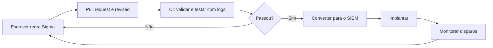

# Detection as Code

## Objetivo
Gerenciar regras de detecção com as mesmas práticas de engenharia de software: versionamento, revisão, testes e implantação automatizada. Mapa: [[MOC - Threat Intel e Detecção]].

## Conceito
**Detection as Code (DaC)** trata cada regra de detecção como um artefato de software em repositório Git. Isso resolve problemas clássicos do SOC: regras editadas direto no console sem histórico, sem testes, sem dono e sem como reverter.

**Ciclo de vida de uma detecção:**

1. **Requisito:** vem de inteligência ([[Feeds de Inteligência de Ameaças]]), incidente ou lacuna de cobertura ([[Framework MITRE ATT&CK]]).
2. **Escrita:** regra em formato portável ([[Regras Sigma - Automação]]) com metadados (técnica, severidade, dono, fontes de log, falsos positivos conhecidos).
3. **Revisão por pares:** pull request.
4. **Teste automatizado:** validação sintática, testes unitários com logs positivos e negativos, e verificação de desempenho ([[Testes de Detecção]]).
5. **Implantação:** conversão para a linguagem do [[SIEM]] ou [[EDR e XDR]] e publicação por pipeline.
6. **Monitoramento:** taxa de disparo, falsos positivos, tempo de execução.
7. **Ajuste ou aposentadoria.**

**Benefícios:** rastreabilidade ([[Trilha de Auditoria]]), reversão fácil ([[Rollback]]), qualidade consistente, escala com a equipe, portabilidade entre plataformas e geração automática de mapa de cobertura.



## Exemplo prático
> [!example] Estrutura de repositório e pipeline
> Cada regra acompanha seus casos de teste.

```text
detections/
  windows/
    proc_powershell_encoded.yml
  tests/
    proc_powershell_encoded/
      positivo.json
      negativo.json
```

```yaml
name: detections-ci
on: [pull_request]
jobs:
  validar:
    runs-on: ubuntu-latest
    steps:
      - uses: actions/checkout@v4
      - run: pip install sigma-cli pytest
      - run: sigma check detections/
      - run: pytest tests/ -q
```

## Boas práticas
- Exija metadados obrigatórios (dono, técnica, severidade, data de revisão).
- Mantenha logs de teste sintéticos e inofensivos junto de cada regra.
- Faça implantação gradual: modo observação antes de gerar alertas.
- Acompanhe métricas por regra e aposente as que não geram valor.
- Documente o procedimento de triagem de cada detecção ([[Runbooks]]).

## Erros comuns
- Regras sem testes, que quebram sem aviso quando o esquema de log muda.
- Edição manual no console, criando divergência com o repositório.
- Alta taxa de falso positivo sem dono para ajustar.
- Cobertura contada por quantidade de regras, e não por testes que comprovam o disparo.

> [!tip] Teste é o diferencial
> Uma regra sem teste é uma hipótese; com teste, é um controle verificável.

## Para revisar
> [!question] Perguntas
> 1. Que problemas o DaC resolve?
> 2. Quais as etapas de CI de uma regra?
> 3. Por que implantar em modo observação?
> 4. Como medir a qualidade de uma detecção ao longo do tempo?

## Links relacionados
[[Infrastructure as Code]], [[Threat Hunting Automatizado]], [[Segurança em Pipelines CI-CD]], [[Métricas - MTTD, MTTR, Falso Positivo e ROI]].
