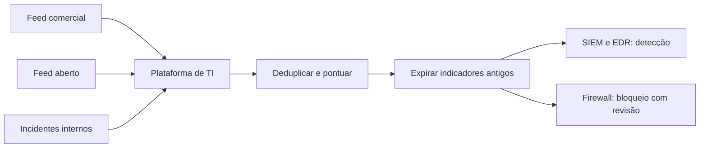

# Feeds de Inteligência de Ameaças

## Objetivo
Selecionar, ingerir e operacionalizar feeds de inteligência de forma que gerem detecção útil, e não apenas volume de indicadores. Mapa: [[MOC - Threat Intel e Detecção]].

## Conceito
Um **feed** é uma fonte contínua de informação sobre ameaças. Há quatro níveis de inteligência, com públicos e usos distintos:

| Nível | Conteúdo | Uso |
|---|---|---|
| Estratégico | Tendências, motivações, setores alvo | Gestão e investimento |
| Operacional | Campanhas e atores em andamento | Planejamento de defesa |
| Tático | TTPs ([[Framework MITRE ATT&CK]]) | Engenharia de detecção |
| Técnico | IOCs: IPs, domínios, hashes | Bloqueio e correlação |

**Tipos de fonte:** comerciais, comunitárias e abertas (como listas de reputação e plataformas colaborativas), governamentais e setoriais (ISACs, CERTs, como o CTIR Gov e o CERT.br), e internas (seus próprios incidentes, a mais relevante de todas).

**Critérios de qualidade de um feed:**

- **Relevância** para seu setor, geografia e tecnologias.
- **Precisão:** taxa de falsos positivos baixa.
- **Atualidade e vida útil:** IOCs de IP expiram rápido; hashes duram mais.
- **Contexto:** descrição, confiança, técnica associada e data de expiração.
- **Formato aberto:** facilita automação ([[STIX e TAXII]]).

**Operacionalização:** ingerir em uma plataforma ([[MISP - Automação]], OpenCTI), deduplicar, pontuar a confiança, aplicar expiração e distribuir para [[SIEM]], [[EDR e XDR]] e firewalls, com revisão de impacto antes de bloquear.



## Exemplo prático
> [!example] Ingestão com validade
> Cada indicador recebe data de expiração conforme o tipo, e só indicadores com confiança acima do mínimo vão para bloqueio.

```python
from datetime import datetime, timedelta, timezone

VALIDADE_DIAS = {"ip": 14, "dominio": 45, "url": 30, "hash": 365}

def preparar(ind: dict, confianca_minima=70):
    agora = datetime.now(timezone.utc)
    ind["expira_em"] = (agora + timedelta(days=VALIDADE_DIAS[ind["tipo"]])).isoformat()
    ind["destino"] = "bloqueio" if ind["confianca"] >= confianca_minima else "somente_deteccao"
    return ind
```

## Boas práticas
- Prefira poucos feeds de alta qualidade a muitos de baixa.
- Meça a utilidade de cada feed (quantos alertas verdadeiros gerou).
- Defina expiração para todo indicador.
- Exclua listas de permissão (CDNs, DNS públicos, parceiros) do bloqueio automático.
- Compartilhe de volta com comunidades de confiança, respeitando o protocolo de sensibilidade (TLP).

## Erros comuns
- Bloquear automaticamente tudo o que um feed publica.
- Ignorar o contexto e a idade do indicador.
- Não medir o retorno, mantendo feeds inúteis.
- Compartilhar dados internos sem classificação.

> [!warning] TLP
> Respeite o Traffic Light Protocol (CLEAR, GREEN, AMBER, RED) ao redistribuir informações recebidas.

## Para revisar
> [!question] Perguntas
> 1. Quais os quatro níveis de inteligência?
> 2. Que critérios avaliam a qualidade de um feed?
> 3. Por que IOCs de IP expiram mais rápido que hashes?
> 4. Por que não bloquear automaticamente tudo?

## Links relacionados
[[Enriquecimento de IOCs]], [[Detection as Code]], [[Threat Hunting Automatizado]], [[Aspectos Legais e LGPD]].
