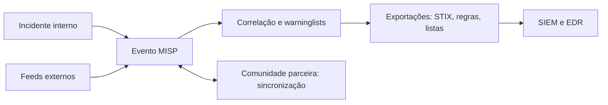

# MISP - Automação

## Objetivo
Usar o MISP como plataforma central para armazenar, correlacionar, compartilhar e distribuir inteligência de ameaças de forma automatizada. Mapa: [[MOC - Threat Intel e Detecção]].

## Conceito
O **MISP** é uma plataforma de código aberto de inteligência de ameaças e compartilhamento de indicadores. Organiza a informação em **eventos**, que agrupam **atributos** (IOCs como IP, domínio, hash, URL) e **objetos** (conjuntos estruturados de atributos relacionados, por exemplo, um arquivo com nome, hash e tamanho).

**Recursos principais:**

- **Correlação automática:** encontra atributos que aparecem em vários eventos, revelando campanhas conectadas.
- **Taxonomias e galáxias:** classificação padronizada, incluindo TLP, técnicas do [[Framework MITRE ATT&CK]], famílias de malware e atores.
- **Sincronização entre instâncias:** compartilhamento com comunidades confiáveis, com controle de distribuição.
- **Feeds:** importação de fontes externas ([[Feeds de Inteligência de Ameaças]]) e exportação de feeds próprios.
- **Formatos de exportação:** STIX ([[STIX e TAXII]]), regras Suricata e Snort, listas para firewall e [[SIEM]], e regras YARA ([[YARA - Automação]]).
- **API REST:** base para automação, com a biblioteca PyMISP.
- **Avisos (warninglists):** listas de valores benignos conhecidos para evitar falsos positivos.
- **Flag "to_ids":** indica quais atributos são adequados para detecção automática.



## Exemplo prático
> [!example] Consultar indicadores prontos para detecção
> O script busca atributos recentes marcados para IDS e os envia ao SIEM, removendo os que constam em listas de avisos.

```python
from pymisp import PyMISP

misp = PyMISP("https://misp.exemplo.local", obter_segredo("MISP_KEY"), ssl=True)
resultado = misp.search(controller="attributes", to_ids=True, last="7d",
                        enforce_warninglist=True, pythonify=True)
for attr in resultado:
    enviar_para_siem(tipo=attr.type, valor=attr.value, evento=attr.event_id)
```

## Boas práticas
- Padronize taxonomias e a política de marcação (TLP) antes de compartilhar.
- Ative as warninglists para reduzir falsos positivos.
- Use `to_ids` com critério: só o que for confiável vira detecção automática.
- Defina expiração e rotina de limpeza de atributos antigos.
- Restrinja permissões por organização e por distribuição do evento.
- Faça backup e atualize a instância; é um sistema com dados sensíveis.

## Erros comuns
- Importar tudo e marcar todos os atributos como IDS.
- Compartilhar sem classificação, vazando informação sensível.
- Instância exposta sem hardening e sem MFA ([[Hardening com CIS Benchmarks]]).
- Não alimentar a plataforma com incidentes internos.

> [!warning] Dados de investigação
> Eventos podem conter dados de incidentes reais. Controle a distribuição e revise antes de compartilhar.

## Para revisar
> [!question] Perguntas
> 1. O que são eventos, atributos e objetos no MISP?
> 2. Para que servem as warninglists?
> 3. Qual o significado da flag `to_ids`?
> 4. Como o MISP se integra ao SIEM?

## Links relacionados
[[Detection as Code]], [[Orquestração via APIs]], [[Playbook de Phishing]], [[Comparativo de Ferramentas - Automação]].
