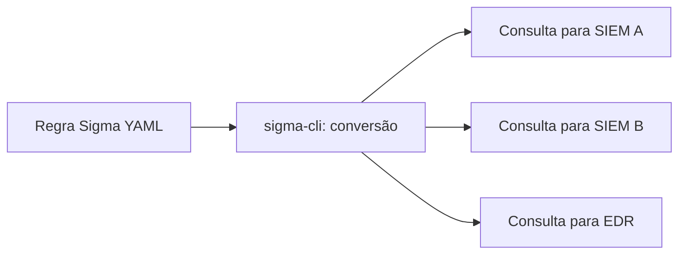

# Regras Sigma - Automação

## Objetivo
Escrever regras de detecção portáveis em Sigma, com qualidade, metadados e conversão para diferentes plataformas. Mapa: [[MOC - Threat Intel e Detecção]].

## Conceito
**Sigma** é um formato aberto, em YAML, para descrever detecções sobre logs de forma independente de produto. Para logs, é o que o Snort é para rede e o [[YARA - Automação]] para arquivos. Uma regra Sigma é convertida (por exemplo, com `sigma-cli` e seus *backends*) para consultas de diversos [[SIEM]] e [[EDR e XDR]].

**Estrutura de uma regra:**

- **Metadados:** `title`, `id`, `status`, `description`, `author`, `date`, `references`.
- **`logsource`:** categoria, produto e serviço (por exemplo, criação de processo no Windows).
- **`detection`:** blocos de seleção e filtros, com uma `condition` lógica.
- **`falsepositives`:** situações legítimas conhecidas.
- **`level`:** severidade (informational a critical).
- **`tags`:** técnicas do [[Framework MITRE ATT&CK]] (`attack.t1059.001`).

**Modificadores de campo:** `contains`, `startswith`, `endswith`, `re`, `all`, entre outros, para expressar a lógica de correspondência.

**Qualidade:** boas regras detectam **comportamento** (o que o adversário precisa fazer) e não apenas valores fixos facilmente alteráveis (como nomes de arquivo). Devem declarar falsos positivos esperados e funcionar com a telemetria realmente disponível.



## Exemplo prático
> [!example] Detecção de PowerShell com comando codificado
> Regra comportamental e defensiva; o uso de comando codificado é legítimo em alguns casos, por isso há filtro e falsos positivos documentados.

```yaml
title: PowerShell com comando codificado
id: 3f6c2b8a-5f0c-4a52-9b1d-0a1c3d4e5f60
status: experimental
description: Detecta PowerShell iniciado com argumento de comando codificado em Base64.
author: Equipe de Detecção
date: 2026/01/15
tags:
  - attack.execution
  - attack.t1059.001
logsource:
  category: process_creation
  product: windows
detection:
  selecao:
    Image|endswith:
      - '\powershell.exe'
      - '\pwsh.exe'
    CommandLine|contains:
      - ' -enc '
      - ' -encodedcommand '
  filtro_gerenciamento:
    ParentImage|endswith: '\ferramenta_gestao_aprovada.exe'
  condition: selecao and not filtro_gerenciamento
falsepositives:
  - Ferramentas de gerenciamento que usam comandos codificados
level: medium
```

```bash
# Converter a regra para uma consulta (backend de exemplo)
sigma convert -t splunk -p splunk_windows detections/proc_powershell_encoded.yml
```

## Boas práticas
- Prefira comportamentos a indicadores frágeis.
- Teste com logs positivos e negativos ([[Testes de Detecção]]).
- Documente filtros e falsos positivos com dono para revisão.
- Use `status` para refletir maturidade (experimental, test, stable).
- Verifique se o campo usado existe no seu esquema de logs (mapeamento de campos).

## Erros comuns
- Regra genérica demais, com enorme volume de falsos positivos.
- Conversão sem mapear campos para o esquema local.
- Não ajustar à telemetria disponível (a regra nunca dispara).
- Falta de versionamento e de testes ([[Detection as Code]]).

> [!warning] Ofuscação
> Adversários mudam valores fixos. Combine sinais comportamentais e contexto para resistir a variações.

## Para revisar
> [!question] Perguntas
> 1. Quais são as seções principais de uma regra Sigma?
> 2. Para que serve o `logsource`?
> 3. Por que preferir comportamento a valores fixos?
> 4. Como converter uma regra para outra plataforma?

## Links relacionados
[[Feeds de Inteligência de Ameaças]], [[Threat Hunting Automatizado]], [[Triagem Automática de Alertas]], [[Emulação de Adversário para Validação Defensiva]].
