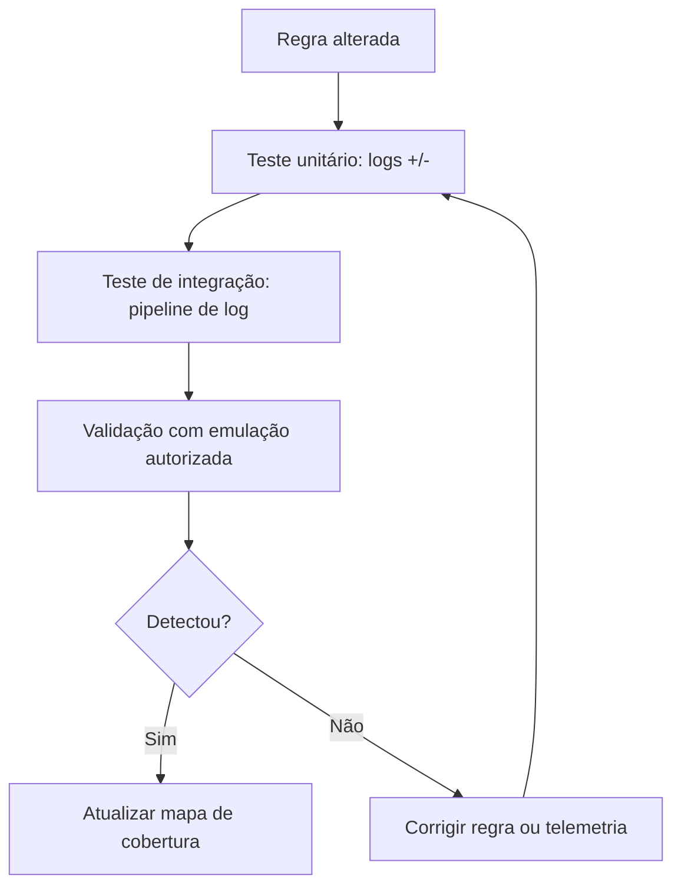

# Testes de Detecção

## Objetivo
Verificar sistematicamente se as detecções disparam quando devem e permanecem silenciosas quando não devem, em todas as etapas do ciclo de vida. Mapa: [[MOC - Threat Intel e Detecção]].

## Conceito
Uma regra que "existe" não é uma regra que "funciona". Mudanças de esquema de log, de versão do agente ou de configuração podem desativá-la silenciosamente. Os **testes de detecção** tornam a cobertura verificável, em três camadas:

1. **Teste unitário da regra:** alimenta a regra com logs sintéticos **positivos** (devem disparar) e **negativos** (não devem). Rápido, roda no CI ([[Detection as Code]]).
2. **Teste de integração do pipeline de log:** confirma que o evento gerado no endpoint chega ao [[SIEM]], é parseado corretamente e dispara o alerta de ponta a ponta.
3. **Validação com emulação:** executa comportamentos de adversário **controlados e inofensivos**, em ambiente autorizado, e verifica a detecção real ([[Emulação de Adversário para Validação Defensiva]]).

**O que medir:**

- **Taxa de detecção** por técnica testada.
- **Latência:** tempo entre a ação e o alerta ([[Métricas - MTTD, MTTR, Falso Positivo e ROI]]).
- **Falsos positivos** em um conjunto de dados de linha de base legítima.
- **Regressão:** testes que passavam e deixaram de passar.
- **Saúde da telemetria:** a fonte de log está ativa?



## Exemplo prático
> [!example] Teste unitário com logs sintéticos
> Casos de teste em Python verificam que a lógica de detecção casa com o evento positivo e ignora o negativo.

```python
def detecta_powershell_codificado(evento: dict) -> bool:
    cmd = evento.get("CommandLine", "").lower()
    img = evento.get("Image", "").lower()
    return img.endswith(("\\powershell.exe", "\\pwsh.exe")) and \
           (" -enc " in cmd or " -encodedcommand " in cmd)

def test_positivo():
    assert detecta_powershell_codificado(
        {"Image": "C:\\Windows\\System32\\powershell.exe",
         "CommandLine": "powershell.exe -enc AAAA"})

def test_negativo():
    assert not detecta_powershell_codificado(
        {"Image": "C:\\Windows\\System32\\powershell.exe",
         "CommandLine": "powershell.exe -File relatorio.ps1"})
```

## Boas práticas
- Guarde os eventos de teste como dados versionados junto da regra.
- Rode os testes a cada alteração de regra e em agenda, para pegar regressões de telemetria.
- Inclua casos limítrofes e variações comuns de evasão (em nível de detecção).
- Registre o resultado por técnica no mapa de cobertura ([[Framework MITRE ATT&CK]]).
- Execute validações com emulação apenas com autorização, em ambientes controlados.

## Erros comuns
- Testar só o caso positivo.
- Confiar no teste unitário sem validar o caminho completo do log.
- Não medir falsos positivos em dados reais de linha de base.
- Teste executado uma vez e nunca repetido.

> [!tip] Detecção silenciosa
> Falha de coleta é o principal motivo de regra "morta". Alerte quando uma fonte de log parar de enviar eventos.

## Para revisar
> [!question] Perguntas
> 1. Quais as três camadas de teste de detecção?
> 2. Por que incluir casos negativos?
> 3. Que métricas indicam a qualidade da cobertura?
> 4. Por que reexecutar testes periodicamente?

## Links relacionados
[[Threat Hunting Automatizado]], [[YARA - Automação]], [[Auditoria Contínua]], [[Lab - Parsing de Logs]].
