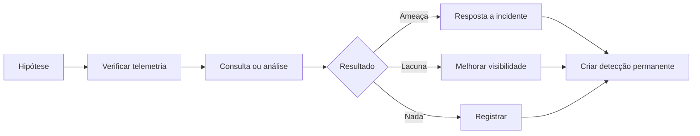

# Threat Hunting Automatizado

## Objetivo
Estruturar a caça a ameaças como processo hipótese-dados-resultado e automatizar suas partes repetíveis, transformando achados em detecções permanentes. Mapa: [[MOC - Threat Intel e Detecção]].

## Conceito
O **threat hunting** é a busca proativa por atividade maliciosa que escapou das detecções existentes. Diferente da resposta a alertas, parte de uma **hipótese**, normalmente derivada de inteligência ([[Feeds de Inteligência de Ameaças]]) ou de uma técnica do [[Framework MITRE ATT&CK]] ("se um adversário usasse esta técnica, que rastros deixaria nos nossos dados?").

**Ciclo de uma caça:**

1. **Hipótese:** clara e testável.
2. **Dados necessários:** verificar se a telemetria existe.
3. **Consulta e análise:** buscas, agregações e análise de raridade (stacking), linha de base e desvio.
4. **Resultado:** ameaça encontrada (aciona resposta), falso alarme, ou lacuna de visibilidade.
5. **Operacionalizar:** transformar a consulta útil em uma detecção permanente ([[Detection as Code]]) e registrar a lição.

**O que automatizar:**

- **Execução agendada** de caças repetíveis (por exemplo, semanais), com resultados em painel.
- **Caça retrospectiva** quando surge novo indicador: procurar nos últimos 30 a 90 dias.
- **Enriquecimento** dos achados antes de chegarem ao analista ([[Enriquecimento de IOCs]]).
- **Análises estatísticas** simples, como raridade de processos, de destinos de rede e de combinações usuário-host.

**O que permanece humano:** formular hipóteses criativas, interpretar contexto e decidir sobre achados ambíguos.



## Exemplo prático
> [!example] Caça por raridade de processo
> Hipótese: processos executados em poucos hosts e raramente vistos podem indicar atividade incomum. O script lista executáveis presentes em no máximo 2 hosts, para revisão humana.

```python
from collections import defaultdict

def processos_raros(eventos, max_hosts=2):
    hosts_por_proc = defaultdict(set)
    for e in eventos:
        hosts_por_proc[e["process_name"].lower()].add(e["hostname"])
    raros = {p: sorted(h) for p, h in hosts_por_proc.items() if len(h) <= max_hosts}
    return dict(sorted(raros.items(), key=lambda kv: len(kv[1])))
```

O resultado é um ponto de partida para investigação, e não um veredito: muitos raros são legítimos (ferramentas de uma única equipe).

## Boas práticas
- Registre hipótese, consulta, dados, resultado e decisão para cada caça, criando uma base de conhecimento.
- Defina listas de permissão para reduzir repetição de falsos alarmes.
- Priorize hipóteses pelo risco e pelo que a inteligência indica.
- Meça o resultado: detecções novas criadas, lacunas descobertas, incidentes encontrados.
- Alinhe as caças ao mapa de cobertura ([[Testes de Detecção]]).

## Erros comuns
- Caçar sem hipótese, apenas "olhando os logs".
- Não converter achados em detecções, repetindo trabalho manual.
- Dados insuficientes e não perceber a lacuna.
- Tratar anomalia estatística como prova de malícia.

> [!tip] Resultado negativo vale
> Uma caça sem achados ainda documenta cobertura e pode revelar falta de telemetria.

## Para revisar
> [!question] Perguntas
> 1. Como se diferencia hunting de resposta a alertas?
> 2. Quais as etapas do ciclo de caça?
> 3. Que partes são boas candidatas à automação?
> 4. Por que operacionalizar a consulta bem-sucedida?

## Links relacionados
[[Emulação de Adversário para Validação Defensiva]], [[SIEM]], [[Regras Sigma - Automação]], [[Lab - Parsing de Logs]].
