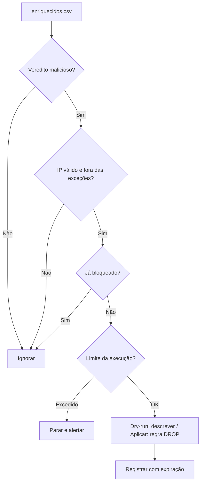

# Lab - Bloqueio Automatizado

## Objetivo
Implementar um bloqueio de IPs maliciosos **seguro por construção**: dry-run por padrão, lista de exceções, limite por execução, TTL com expiração e registro de estado para reversão. Mapa: [[MOC - Laboratórios e Scripts]].

> [!warning] Escopo
> Use apenas em máquina de laboratório própria, onde você tenha autorização. Por padrão o script **não aplica nada**: ele só descreve o que faria. A aplicação exige a opção explícita `--aplicar` e privilégios de administrador. O exemplo usa `iptables`; adapte ao firewall do seu ambiente.

## Conceito
Este laboratório materializa os princípios de [[Contenção Automatizada]]:

- **Proporcionalidade e reversibilidade:** o bloqueio é um DROP temporário e removível.
- **Lista de exceções:** redes privadas e loopback jamais são bloqueadas.
- **Limite de taxa por execução:** um teto de ações evita bloqueio em massa por dados defeituosos.
- **TTL:** cada bloqueio expira; o estado fica em arquivo para que a expiração remova a regra.
- **Idempotência:** IP já bloqueado não é bloqueado de novo.
- **Validação rigorosa:** só endereços IPv4 válidos; os comandos são montados como lista (sem passar por shell), evitando injeção de comandos.



## Exemplo prático
Salve como `bloquear.py`.

```python
#!/usr/bin/env python3
"""Bloqueio automatizado e reversível. Dry-run por padrão."""
import argparse, csv, ipaddress, json, logging, subprocess, time
from pathlib import Path

ESTADO = Path("bloqueios.json")
TTL_S = 24 * 3600
MAX_POR_EXECUCAO = 20
NUNCA_BLOQUEAR = [ipaddress.ip_network(n) for n in
                  ("10.0.0.0/8", "172.16.0.0/12", "192.168.0.0/16", "127.0.0.0/8")]
logging.basicConfig(level=logging.INFO, format="%(asctime)s %(levelname)s %(message)s")

def pode_bloquear(texto):
    try:
        ip = ipaddress.ip_address(texto)
    except ValueError:
        return False
    if ip.version != 4 or ip.is_loopback or ip.is_multicast or ip.is_unspecified:
        return False
    return not any(ip in rede for rede in NUNCA_BLOQUEAR)

def regra(acao, ip):  # acao: "-I" (inserir) ou "-D" (remover)
    return ["iptables", acao, "INPUT", "-s", ip, "-j", "DROP",
            "-m", "comment", "--comment", "auto-bloqueio-lab"]

def carregar():
    try:
        return json.loads(ESTADO.read_text(encoding="utf-8"))
    except (FileNotFoundError, json.JSONDecodeError):
        return {}

def salvar(estado):
    ESTADO.write_text(json.dumps(estado, indent=2), encoding="utf-8")

def expirar(estado, aplicar):
    agora = time.time()
    for ip in [i for i, d in estado.items() if d["expira"] <= agora]:
        if aplicar:
            subprocess.run(regra("-D", ip), check=True)
            del estado[ip]
        logging.info("%s expiração do bloqueio de %s", "" if aplicar else "[DRY-RUN]", ip)

def bloquear(caminho, estado, aplicar):
    feitos = 0
    with open(caminho, newline="", encoding="utf-8") as f:
        for linha in csv.DictReader(f):
            ip = linha["ip"].strip()
            if linha.get("veredito") != "malicioso" or not pode_bloquear(ip) or ip in estado:
                continue
            if feitos >= MAX_POR_EXECUCAO:
                logging.warning("limite de %d bloqueios atingido; escalar para humano", MAX_POR_EXECUCAO)
                break
            if aplicar:
                subprocess.run(regra("-I", ip), check=True)
                estado[ip] = {"expira": time.time() + TTL_S, "motivo": "veredito malicioso"}
                logging.info("bloqueado %s (TTL %dh)", ip, TTL_S // 3600)
            else:
                logging.info("[DRY-RUN] bloquearia %s", ip)
            feitos += 1

def main():
    ap = argparse.ArgumentParser()
    ap.add_argument("arquivo", nargs="?")
    ap.add_argument("--aplicar", action="store_true", help="executa de verdade")
    ap.add_argument("--expirar", action="store_true", help="remove bloqueios vencidos")
    args = ap.parse_args()
    estado = carregar()
    if args.expirar:
        expirar(estado, args.aplicar)
    elif args.arquivo:
        bloquear(args.arquivo, estado, args.aplicar)
    if args.aplicar:
        salvar(estado)

if __name__ == "__main__":
    main()
```

Uso: `python3 bloquear.py enriquecidos.csv` (simulação) e, só em laboratório autorizado, `sudo python3 bloquear.py enriquecidos.csv --aplicar`. Para reverter vencidos: `sudo python3 bloquear.py --expirar --aplicar`.

## Boas práticas
- Mantenha dry-run como padrão e exija confirmação explícita para agir.
- Notifique o dono do ativo e registre tudo na [[Trilha de Auditoria]].
- Revise periodicamente a lista de exceções (inclua DNS, gateways e parceiros).
- Em produção, aplique a ação via API do firewall, com aprovação para alto risco ([[Human in the Loop - Automação]]).
- Teste a remoção com a mesma atenção da inserção ([[Rollback]]).

## Erros comuns
- Bloquear sem TTL, acumulando regras indefinidamente.
- Montar comandos concatenando texto vindo de arquivos, abrindo brecha de injeção.
- Ausência de teto por execução.
- Esquecer o IPv6 ao proteger um host dual-stack.

## Para revisar
> [!question] Perguntas
> 1. Por que o dry-run é o padrão?
> 2. Como o script evita injeção de comandos?
> 3. Qual a função do TTL e do estado em arquivo?
> 4. Por que limitar o número de bloqueios por execução?

## Links relacionados
[[Lab - Enriquecimento de IOCs]], [[Playbook de Malware]], [[SOAR]], [[Governança da Automação]].
