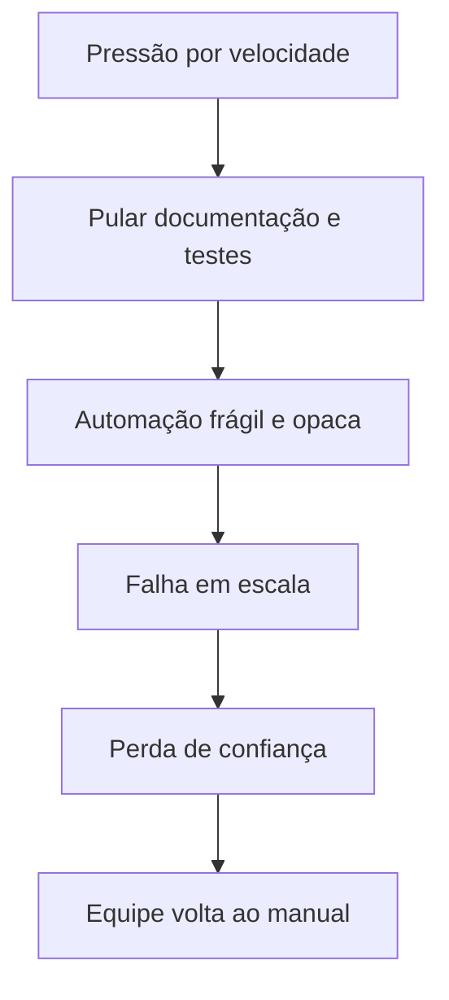

# Anti-Padrões de Automação de Segurança

## Objetivo
Reconhecer os erros recorrentes que transformam automação em risco ou em desperdício, e saber o que fazer em vez deles. Mapa: [[MOC - IA, Governança e Boas Práticas]].

## Conceito
Um **anti-padrão** é uma solução aparentemente razoável que, na prática, produz resultados ruins. Os principais em automação de segurança:

| Anti-padrão | Consequência | Alternativa |
|---|---|---|
| **Automatizar o caos:** fluxo sem processo definido | Erro em escala | Documentar o [[Runbooks\|runbook]] antes ([[Ciclo de Vida da Automação]]) |
| **Contenção sem rollback** | Falsos positivos causam indisponibilidade | Ações reversíveis e TTL ([[Rollback]]) |
| **Sem lista de exceções** | Bloqueio de CEO, DNS ou produção | Exceções com dono e validade |
| **Credenciais fixas no código** | Vazamento e movimentação lateral | Cofre e tokens curtos ([[Gestão de Segredos]]) |
| **Conta de serviço superprivilegiada** | Impacto máximo em caso de abuso | Privilégio mínimo ([[Segregação de Funções]]) |
| **Automação sem dono** | Obsolescência e riscos esquecidos | Inventário e revisão ([[Governança da Automação]]) |
| **Sem monitorar a automação** | Falha silenciosa | Alertas de saúde e métricas |
| **Fechar alertas automaticamente sem amostragem** | Falsos negativos ocultos | Auditoria por amostragem ([[Triagem Automática de Alertas]]) |
| **Aprovação cega (carimbo)** | Controle apenas aparente | Pedidos com evidências ([[Human in the Loop - Automação]]) |
| **Plataforma antes do processo** | Ferramenta cara e subutilizada | Maturidade gradual ([[Níveis de Maturidade da Automação]]) |
| **IA com poder de agir sozinha** | Injeção de prompt vira incidente | Recomendar e validar ([[Riscos de IA em Segurança]]) |
| **Métrica-vaidade** (nº de playbooks, alertas fechados) | Otimizar o que não importa | Métricas de resultado ([[Métricas - MTTD, MTTR, Falso Positivo e ROI]]) |
| **Sem testes de detecção** | Cobertura ilusória | [[Testes de Detecção]] contínuos |
| **Dependência de um único fornecedor/pessoa** | Ponto único de falha | Formatos abertos, documentação, rodízio |
| **Ausência de kill switch** | Sem como parar um fluxo defeituoso | Pausa global testada |

**Padrão por trás da maioria:** priorizar velocidade e quantidade sobre **controle, verificação e reversibilidade**.



## Exemplo prático
> [!example] Antes e depois
> **Antes:** um script bloqueia qualquer IP citado em um feed, com credencial de administrador embutida e sem registro. Um feed publica por engano um IP de DNS público e a empresa fica sem resolução de nomes por horas.
> **Depois:** o fluxo exige confiança mínima, consulta lista de exceções, aplica bloqueio com TTL, respeita limite por execução, registra a ação e oferece reversão em lote.

```yaml
politica_bloqueio:
  confianca_minima: 0.85
  excecoes: [dns_publico, gateways, parceiros]
  ttl: 24h
  max_por_execucao: 20
  auditoria: obrigatoria
  reversao: lote_e_individual
```

## Boas práticas
- Faça uma revisão "pré-mortem" de cada automação: "como isto falharia?".
- Use listas de verificação de implantação com os itens acima.
- Promova gradualmente: observação, recomendação, ação com aprovação, ação automática.
- Compartilhe lições aprendidas após cada falha, sem culpabilização.

## Erros comuns
- Corrigir só o sintoma de uma falha, sem revisar o padrão.
- Esconder incidentes causados pela própria automação.
- Tratar o anti-padrão como "dívida a pagar depois".

> [!warning] Efeito de escala
> A mesma qualidade que torna a automação valiosa (agir rápido e em volume) amplifica seus erros.

## Para revisar
> [!question] Perguntas
> 1. Cite cinco anti-padrões e a alternativa de cada um.
> 2. Por que "automatizar o caos" é perigoso?
> 3. O que é uma análise pré-mortem?
> 4. Por que métricas-vaidade são enganosas?

## Links relacionados
[[Por que Automatizar Segurança]], [[O que Automatizar e o que Não Automatizar]], [[Trilha de Auditoria]], [[IA e LLMs na Automação de Segurança]].
