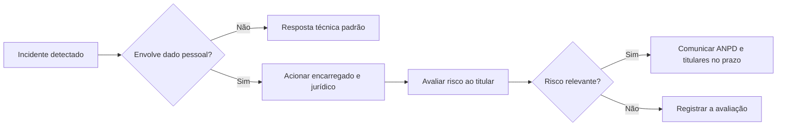

# Aspectos Legais e LGPD

## Objetivo
Compreender as principais obrigações legais que afetam a automação de segurança no Brasil, em especial a proteção de dados pessoais, e incorporá-las ao desenho de fluxos e ferramentas. Mapa: [[MOC - IA, Governança e Boas Práticas]].

> [!warning] Aviso
> Este conteúdo é educacional e não substitui aconselhamento jurídico. Leis, regulamentos e prazos mudam; confirme sempre a norma vigente com o jurídico e o encarregado (DPO) da sua organização.

## Conceito
**Lei Geral de Proteção de Dados (Lei nº 13.709/2018).** Regula o tratamento de dados pessoais. Pontos de contato com a segurança automatizada:

- **Princípios (art. 6º):** finalidade, adequação, **necessidade** (minimização), livre acesso, qualidade, transparência, **segurança**, **prevenção**, não discriminação e **responsabilização e prestação de contas**.
- **Segurança (art. 46):** os agentes de tratamento devem adotar medidas técnicas e administrativas para proteger os dados contra acessos não autorizados e situações acidentais ou ilícitas. A própria automação de segurança é uma dessas medidas.
- **Base legal:** o tratamento de logs e dados de usuários para segurança costuma se apoiar em hipóteses como cumprimento de obrigação legal ou regulatória e legítimo interesse (com avaliação de impacto e balanceamento), a validar com o jurídico.
- **Registro das operações (art. 37):** manter registro das atividades de tratamento, o que se articula com a [[Trilha de Auditoria]].
- **Encarregado (art. 41):** canal com titulares e com a ANPD; deve ser acionado em incidentes ([[Playbook de Exfiltração de Dados]]).
- **Comunicação de incidente (art. 48):** incidentes que possam acarretar risco ou dano relevante aos titulares devem ser comunicados à ANPD e aos titulares. A regulamentação da ANPD fixa prazo para a comunicação (a Resolução CD/ANPD nº 15/2024 prevê três dias úteis); verifique a regra vigente.
- **Decisões automatizadas (art. 20):** o titular pode solicitar a revisão de decisões tomadas unicamente com base em tratamento automatizado que afetem seus interesses. Atenção a ações automáticas contra usuários (bloqueio de conta, por exemplo), que devem ser explicáveis e revisáveis ([[Human in the Loop - Automação]]).
- **Transferência internacional (arts. 33 e seguintes):** enviar dados a serviços de IA ou de inteligência hospedados no exterior exige base e salvaguardas adequadas ([[Riscos de IA em Segurança]]).

**Outras normas relevantes:** o Marco Civil da Internet (Lei nº 12.965/2014), que define prazos de guarda de registros de conexão e de acesso a aplicações; a Lei nº 12.737/2012, que tipifica a invasão de dispositivo informático (por isso, testes e varreduras exigem **autorização**); normas setoriais (financeiro, saúde, órgãos públicos) e o contrato com clientes.



## Exemplo prático
> [!example] Minimização e pseudonimização em logs
> Antes de enviar eventos a uma plataforma externa, o fluxo substitui identificadores diretos por pseudônimos estáveis, permitindo correlação sem expor o dado.

```python
import hmac, hashlib, os

def pseudonimizar(valor: str) -> str:
    chave = os.environ["PSEUDO_KEY"].encode()  # guardada no cofre
    return hmac.new(chave, valor.lower().encode(), hashlib.sha256).hexdigest()[:16]

evento = {"usuario": pseudonimizar("maria@exemplo.com.br"),
          "acao": "login_falho", "origem": "203.0.113.50"}
```

Lembre-se: pseudonimização **reduz** o risco, mas o dado continua sendo pessoal se a reidentificação for possível.

## Boas práticas
- Envolva o encarregado e o jurídico desde o projeto (privacy by design).
- Aplique minimização, retenção definida e controle de acesso aos dados de segurança.
- Documente base legal e finalidade das coletas de monitoramento e comunique-as nas políticas internas.
- Mantenha contratos e avaliação de fornecedores (operadores) com cláusulas de proteção de dados.
- Tenha procedimento de incidente com pessoas e prazos definidos ([[Runbooks]]).
- Garanta autorização formal para testes, varreduras e emulações ([[Emulação de Adversário para Validação Defensiva]]).

## Erros comuns
- Coletar logs em excesso, sem finalidade clara.
- Enviar dados pessoais a serviços de terceiros sem avaliação.
- Atrasar a comunicação de incidente por não saber quem acionar.
- Ignorar o direito de revisão de decisões automatizadas.
- Realizar varreduras ou testes sem autorização.

> [!tip] Segurança e privacidade são aliadas
> Boas práticas de segurança (controle de acesso, criptografia, logs) são também requisitos de proteção de dados.

## Para revisar
> [!question] Perguntas
> 1. Quais princípios da LGPD mais afetam a coleta de logs?
> 2. Quando e a quem se comunica um incidente com dados pessoais?
> 3. O que o art. 20 implica para bloqueios automáticos de contas?
> 4. Por que testes de segurança exigem autorização formal?
> 5. Pseudonimização equivale a anonimização?

## Links relacionados
[[Governança da Automação]], [[Gestão de Casos]], [[Enriquecimento de IOCs]], [[Compliance as Code]].
