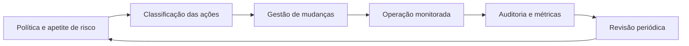

# Governança da Automação

## Objetivo
Estabelecer papéis, políticas e controles que mantenham as automações de segurança confiáveis, auditáveis e alinhadas ao apetite de risco. Mapa: [[MOC - IA, Governança e Boas Práticas]].

## Conceito
Automações de segurança operam com privilégios altos e agem em escala. Sem governança, tornam-se um risco: scripts sem dono, credenciais órfãs, ações sem registro. A governança responde a quem **decide**, quem **constrói**, quem **aprova**, quem **opera** e quem **audita**.

**Elementos centrais:**

1. **Inventário de automações:** catálogo com dono, finalidade, sistemas acessados, privilégios, nível de risco e data da última revisão. Funciona como o [[Inventário de Ativos]], mas para fluxos.
2. **Classificação de risco das ações:** escada de impacto ([[Contenção Automatizada]]) que define o nível de aprovação exigido ([[Human in the Loop - Automação]]).
3. **Papéis e responsabilidades (RACI):** dono do processo, desenvolvedor, revisor, aprovador e operador ([[Segregação de Funções]]).
4. **Gestão de mudanças:** alterações em playbooks passam por revisão, teste e aprovação, como código ([[Ciclo de Vida da Automação]]).
5. **Privilégio mínimo e gestão de segredos** ([[Gestão de Segredos]]).
6. **Trilha de auditoria** completa ([[Trilha de Auditoria]]).
7. **Plano de contingência:** kill switch, modo manual e reversão ([[Rollback]]).
8. **Revisão periódica:** recertificação de dono, de acessos e de utilidade; aposentadoria dos obsoletos.
9. **Métricas e indicadores de risco:** falhas, ações revertidas, exceções ativas ([[Métricas - MTTD, MTTR, Falso Positivo e ROI]]).
10. **Uso de IA:** política específica, com casos permitidos, dados proibidos e supervisão ([[IA e LLMs na Automação de Segurança]]).



## Exemplo prático
> [!example] Registro de automação
> Cada automação é descrita em um arquivo versionado, que alimenta o inventário e a revisão trimestral.

```yaml
automacao: bloqueio_ip_malicioso
dono: equipe-soc
revisor: engenharia-de-deteccao
risco: medio
acoes: [bloquear_ip_ttl]
aprovacao: automatica_se_confianca>=0.9
credencial: svc-firewall (cofre: secret/firewall)
excecoes: [rede_corporativa, parceiros_homologados]
ultima_revisao: 2026-09-30
proxima_revisao: 2026-12-30
kill_switch: flag_pausa_global
```

## Boas práticas
- Nenhuma automação em produção sem dono nomeado.
- Revise acessos e utilidade a cada trimestre.
- Teste periodicamente o kill switch e a operação manual de contingência.
- Documente exceções com validade.
- Integre a governança ao [[Framework NIST CSF]] (função Govern) e à [[Auditoria Contínua]].

## Erros comuns
- Governança "de papel", sem inventário real.
- Automações criadas fora do processo (shadow automation).
- Sem plano de saída quando a automação falha.
- Excesso de burocracia que leva as equipes a contornar o processo.

> [!tip] Proporcionalidade
> Governança deve ser proporcional ao risco: leve para ações de leitura, rigorosa para contenção e acesso privilegiado.

## Para revisar
> [!question] Perguntas
> 1. Que informações um inventário de automações deve ter?
> 2. Por que classificar o risco das ações?
> 3. O que é um kill switch e por que testá-lo?
> 4. Como evitar burocracia excessiva?

## Links relacionados
[[Anti-Padrões de Automação de Segurança]], [[Aspectos Legais e LGPD]], [[Riscos de IA em Segurança]], [[Compliance as Code]].
