# Home - Cpp

Vault completo sobre **C++ moderno** (C++11 a C++23, com notas sobre C++26), em português do Brasil: teoria, exemplos compiláveis, exercícios com gabarito, projetos e referência.

> [!info] Comece aqui
> 1. Siga a [[Trilha de aprendizado - Cpp]] com o [[Roteiro Semanal]] (16 semanas).
> 2. Consulte o [[Índice - Cpp]] para achar qualquer nota.

## Seções

- **00 — Início:** [[Índice - Cpp]] · [[Trilha de aprendizado - Cpp]]
- **01 — Fundamentos:** [[MOC - Fundamentos - Cpp]]
- **02 — Básico da Linguagem:** [[MOC - Básico da Linguagem - Cpp]]
- **03 — Ponteiros e Memória:** [[MOC - Ponteiros e Memória]]
- **04 — Classes e POO:** [[MOC - Classes e POO]]
- **05 — RAII e Move:** [[MOC - RAII e Move]]
- **06 — Templates e Concepts:** [[MOC - Templates e Concepts]]
- **07 — STL e Ranges:** [[MOC - STL e Ranges]]
- **08 — Erros e Exceções:** [[MOC - Erros e Exceções]]
- **09 — Strings e IO:** [[MOC - Strings e IO]]
- **10 — Concorrência e Corrotinas:** [[MOC - Concorrência e Corrotinas]]
- **11 — Módulos e Organização:** [[MOC - Módulos e Organização]]
- **12 — Build e Ferramentas:** [[MOC - Build e Ferramentas]]
- **13 — Testes e Qualidade:** [[MOC - Testes e Qualidade - Cpp]]
- **14 — Bibliotecas:** [[MOC - Bibliotecas]]
- **15 — Áreas de Aplicação:** [[MOC - Áreas de Aplicação - Cpp]]
- **16 — Avançado e Performance:** [[MOC - Avançado e Performance - Cpp]]
- **17 — Projetos:** [[MOC - Projetos - Cpp]]
- **18 — Referência:** [[MOC - Referência - Cpp]]
- **19 — Exercícios:** [[MOC - Exercícios - Cpp]]
- **Checklists e roteiros:** [[MOC - Checklists e Roteiros - Cpp]] (os canvases estão em [[MOC - Anexos]])
- **Templates:** modelos de nota na pasta `Templates` da raiz do vault ([[MOC - Templates]])

## Trilha de estudos

```mermaid
flowchart LR
    A[Fundamentos 01] --> B[Básico 02]
    B --> C[Memória 03]
    C --> D[Classes 04]
    D --> E[RAII e Move 05]
    E --> F[STL 07]
    F --> G[Templates 06]
    G --> H[Erros e IO 08-09]
    H --> I[Build e Testes 11-13]
    I --> J[Concorrência 10]
    J --> K[Avançado 14-16]
    K --> L[Projetos 17]
```

| Fase | Pastas | Nível |
|---|---|---|
| Base | 01, 02, 03 | iniciante |
| Orientação a objetos e recursos | 04, 05 | intermediário |
| Biblioteca e genericidade | 06, 07, 08, 09 | intermediário |
| Profissionalização | 11, 12, 13 | intermediário |
| Especialização | 10, 14, 15, 16 | avançado |
| Prática | 17, 19 | todos |

Detalhes: [[Trilha de aprendizado - Cpp]] e [[Roteiro Semanal]].

## Atalhos

| Preciso de... | Vá para |
|---|---|
| Um termo desconhecido | [[Glossário#C++]] |
| Sintaxe rápida | [[Cheat Sheet de Sintaxe - Cpp]] · [[Cheat Sheet da STL]] · [[Cheat Sheet de Templates]] |
| Entender um erro de build | [[Tabela de Erros de Compilador e Linker]] |
| Evitar bugs clássicos | [[Erros Comuns de Iniciantes - Cpp]] · [[Catálogo de Armadilhas e UB]] |
| Praticar | [[MOC - Exercícios - Cpp]] · [[Flashcards - Cpp]] |
| Um projeto | [[MOC - Projetos - Cpp]] |
| Checklists | [[Checklist de Revisão de Código - Cpp]] · [[Checklist de Novo Projeto - Cpp]] · [[Checklist de Desempenho e Segurança]] |
| Livros e comunidades | [[Livros Cursos e Comunidades - Cpp]] |
| Dúvidas frequentes | [[FAQ - Cpp]] |

## Mapas visuais (Canvas)

- [[Mapa do Gerenciamento de Recursos.canvas]]
- [[Trilha de Aprendizado em Cpp.canvas]]
- [[Mapa da STL.canvas]]

## Índice geral

Todas as notas de A a Z em [[Índice - Cpp]].

> [!question] Verificar na documentação oficial
> Padrões e compiladores evoluem. Confirme versões e suporte em [[Suporte dos Compiladores aos Padrões]] e na documentação de cada compilador.

## Veja também

- [[Trilha de aprendizado - Cpp]]
- [[Índice - Cpp]]
- [[MOC - Checklists e Roteiros - Cpp]]
