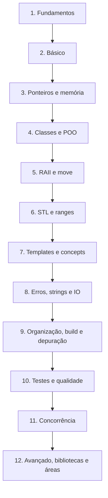

# Trilha de aprendizado - Cpp

Ordem sugerida para aprender C++ moderno. Cada fase termina com uma **lista de exercícios** e um **marco** (algo que você consegue construir). Versão visual: canvas `Trilha de Aprendizado em Cpp` (nesta pasta). Cronograma: [[Roteiro Semanal]].

## Fase 1 — Fundamentos (iniciante)

[[O que é Cpp]] → [[Pipeline de Compilação - Cpp]] → [[Primeiro Programa]] → [[Flags Essenciais do Compilador]] → [[Escolhendo o Padrão com -std]].
**Marco:** compilar e rodar "olá, mundo" com `-Wall -Wextra`.

## Fase 2 — Básico da linguagem (iniciante)

[[Tipos Fundamentais]] → [[Variáveis e Inicialização]] → [[const e constexpr]] → [[Operadores - Cpp]] → [[Controle de Fluxo]] → [[Funções - Cpp]] → [[Sobrecarga de Funções]] → [[Strings C e std string]] → [[Arrays e std array]] → [[Structured Bindings]] → [[Comportamento Indefinido e Não Especificado]].
**Exercícios:** [[Exercícios de Fundamentos e Básico]]. **Marco:** [[Projeto 1 - Calculadora de Expressões]].

## Fase 3 — Ponteiros e memória (iniciante → intermediário)

[[Ponteiros]] → [[Referências - Cpp]] → [[Stack vs Heap]] → [[new e delete]] → [[Vazamentos e Dangling Pointers]] → [[Lvalue e Rvalue]].
**Exercícios:** [[Exercícios de Ponteiros e Memória]].

## Fase 4 — Classes e POO (intermediário)

[[Classes e Structs]] → [[Construtores e Destrutores]] → [[Herança]] → [[Polimorfismo e Funções Virtuais]] → [[Sobrecarga de Operadores - Cpp]].

## Fase 5 — RAII e movimento (intermediário)

[[RAII]] → [[Regra do 0, 3 e 5]] → [[Semântica de Movimento]] → [[unique_ptr]] → [[shared_ptr]].
**Exercícios:** [[Exercícios de Classes e RAII]]. **Marco:** [[Projeto 2 - Gerenciador de Tarefas CLI]].

## Fase 6 — STL e ranges (intermediário)

[[Visão Geral da STL]] → [[vector]] → [[map e set]] → [[Algoritmos da STL]] → [[Lambdas e Captura]] → [[Ranges e Views]] → [[optional]] → [[variant]].
**Exercícios:** [[Exercícios de STL e Ranges]]. **Marco:** [[Projeto 8 - Jogo da Vida]].

## Fase 7 — Templates e concepts (intermediário → avançado)

[[Templates de Função]] → [[Templates de Classe]] → [[Concepts e requires]] → [[Variadic Templates e Fold Expressions]] → [[if constexpr]].
**Exercícios:** [[Exercícios de Templates e Concepts]]. **Marco:** [[Projeto 3 - Biblioteca de Matrizes]].

## Fase 8 — Erros, strings e IO (intermediário)

[[Exceções try catch throw]] → [[Segurança de Exceções]] → [[Tratamento de Erros com expected]] → [[Streams e iostream]] → [[Formatação std format e std print]] → [[std filesystem]].
**Exercícios:** [[Exercícios de Erros Strings e IO]]. **Marco:** [[Projeto 9 - Parser JSON]].

## Fase 9 — Organização, build e depuração (intermediário)

[[Headers vs Sources]] → [[Declaração vs Definição e ODR]] → [[Módulos Cpp20]] → [[CMake Moderno e Presets]] → [[Sanitizers]] → [[Depuração com GDB LLDB e Visual Studio]] → [[vcpkg e Conan]].

## Fase 10 — Testes e qualidade (intermediário)

[[Fundamentos de Testes Unitários]] → [[GoogleTest]] → [[clang-tidy e cppcheck]] → [[clang-format]] → [[Core Guidelines]] → [[CI e CD para Cpp]].

## Fase 11 — Concorrência (avançado)

[[Threads e jthread]] → [[Mutex e Locks]] → [[Atomics e Modelo de Memória]] → [[condition_variable]] → [[future promise e async]] → [[Corrotinas Cpp20]].
**Exercícios:** [[Exercícios de Concorrência - Cpp]]. **Marco:** [[Projeto 4 - Thread Pool]].

## Fase 12 — Avançado, bibliotecas e áreas (avançado)

[[Cache e Localidade de Dados]] → [[Profiling e Benchmarking]] → [[CRTP e Mixins]] → [[Type Erasure]] → [[Boost]] → [[Visão Geral das Bibliotecas]] → escolha uma área em [[MOC - Áreas de Aplicação - Cpp]].
**Exercícios:** [[Desafios Avançados]]. **Marcos:** [[Projeto 5 - Servidor de Chat TCP]], [[Projeto 7 - Máquina Virtual de Bytecode]].

> [!tip] Ritmo
> Não pule as fases 3 e 5: ponteiros e RAII sustentam todo o resto. Revise com [[Flashcards - Cpp]].

## Veja também

- [[Roteiro Semanal]]
- [[MOC - Exercícios - Cpp]]
- [[MOC - Projetos - Cpp]]
- [[Livros Cursos e Comunidades - Cpp]]
- [[MOC - Checklists e Roteiros - Cpp]]

## Exercício

Marque em que fase você está e escreva, para a próxima fase, 3 perguntas que espera responder ao concluí-la.
