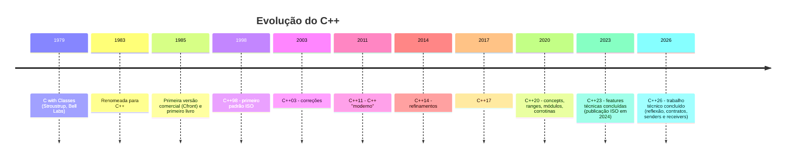

# História e evolução dos padrões

## Linha do tempo



## Padrões e o que trouxeram

| Padrão | Ano | Destaques |
|---|---|---|
| **C++98** | 1998 | STL (contêineres, iteradores, algoritmos), templates, exceções, namespaces, `bool`, RTTI |
| **C++03** | 2003 | Correção de defeitos de C++98; sem recursos novos relevantes |
| **C++11** | 2011 | `auto`, range-for, lambdas, `nullptr`, move semantics, smart pointers, `constexpr`, threads, `enum class`, variadic templates, `override`/`final` |
| **C++14** | 2014 | Lambdas genéricas, `auto` em retorno, `make_unique`, `constexpr` relaxado, variable templates |
| **C++17** | 2017 | Structured bindings, `if constexpr`, `std::optional`/`variant`/`string_view`, CTAD, fold expressions, `std::filesystem`, algoritmos paralelos, `inline` variables |
| **C++20** | 2020 | **Concepts**, **ranges**, **módulos**, **corrotinas**, `operator<=>`, `consteval`/`constinit`, `std::format`, `std::span`, `jthread`, `latch`/`barrier`/`semaphore` |
| **C++23** | 2024 (publicação) | `std::expected`, `std::print`, `std::flat_map`, *deducing this*, `import std;`, `std::mdspan`, `std::generator`, `if consteval`, `std::stacktrace` |
| **C++26** | 2026 (em publicação) | Reflexão estática, contratos, `std::execution`, comportamento errôneo para leituras não inicializadas, biblioteca "hardened" — ver [[Cpp26 Visão Geral]] |

> [!info] Ciclo de três anos
> Desde o C++11 o comitê adota um *train model*: uma nova revisão a cada três anos (2014, 2017, 2020, 2023, 2026). O que não fica pronto a tempo espera o próximo trem.

> [!info] Situação do C++26 (consulta em 24/10/2026)
> O comitê WG21 concluiu o trabalho técnico do C++26 em março de 2026 (reunião em Croydon, Reino Unido). A publicação formal pela ISO depende de etapas de votação e edição.
> [!question] Verificar na documentação oficial
> Confirme em isocpp.org o estado atual da publicação ISO do C++26.

## Por que conhecer a história?

- Código legado usa estilos de épocas diferentes; reconhecer "C++98 style" ajuda a modernizar.
- A flag `-std=` ([[Escolhendo o Padrão com -std]]) determina quais recursos estão disponíveis.
- Muitos conselhos antigos (por exemplo, "evite `auto`") ficaram obsoletos.

## Antes e depois: o mesmo programa em C++98 e em C++20

```cpp
// g++ -std=c++20 -Wall -Wextra
#include <algorithm>
#include <iostream>
#include <vector>

int main() {
    std::vector<int> v{5, 2, 8, 1};

    // Estilo C++98 (ainda compila, mas verboso):
    //   for (std::vector<int>::iterator it = v.begin(); it != v.end(); ++it) ...

    // Estilo moderno:
    std::ranges::sort(v);                    // C++20: algoritmo com ranges
    for (int x : v) std::cout << x << ' ';   // C++11: range-for
    std::cout << '\n';                       // 1 2 5 8
}
```

## Veja também

- [[O que é Cpp]]
- [[Escolhendo o Padrão com -std]]
- [[Suporte dos Compiladores aos Padrões]]
- [[Cpp26 Visão Geral]]
- [[Filosofia do Cpp]]

## Exercício

1. Qual padrão introduziu move semantics? E concepts?
2. Reescreva mentalmente um laço com `std::vector<int>::iterator` usando range-for.
