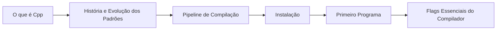

# MOC - Fundamentos - Cpp

Primeira etapa da trilha: o que é C++, de onde veio, como o código vira programa e como preparar o ambiente.

## Conceitos e contexto

- [[O que é Cpp]]
- [[História e Evolução dos Padrões]]
- [[Filosofia do Cpp]]
- [[Casos de Uso do Cpp]]

## Comparações

- [[Cpp vs C]]
- [[Cpp vs Rust, Java, Go e Python]]

## Compilação e compiladores

- [[Pipeline de Compilação - Cpp]]
- [[Compiladores GCC Clang e MSVC]]
- [[Flags Essenciais do Compilador]]
- [[Escolhendo o Padrão com -std]]
- [[Suporte dos Compiladores aos Padrões]]

## Ambiente de desenvolvimento

- [[Instalação no Linux - Cpp]]
- [[Instalação no Windows]]
- [[Instalação no macOS - Cpp]]
- [[IDEs e Editores]]

## Primeiros passos

- [[Primeiro Programa]]

## Olhando adiante

- [[Cpp26 Visão Geral]]

## Ordem de leitura sugerida

## Veja também

- [[Home - Cpp]]
