# MOC - Básico da Linguagem - Cpp

Os blocos de construção de qualquer programa C++: tipos, variáveis, expressões, controle de fluxo, funções, texto e dados básicos.

## Tipos e variáveis

- [[Tipos Fundamentais]]
- [[Variáveis e Inicialização]]
- [[const e constexpr]]
- [[auto e decltype]]
- [[Conversões e Casts]]

## Expressões e controle de fluxo

- [[Operadores - Cpp]]
- [[Controle de Fluxo]]
- [[Range-for e Inicializadores]]

## Funções

- [[Funções - Cpp]]
- [[Sobrecarga de Funções]]
- [[Argumentos Padrão e inline]]

## Escopo e organização de nomes

- [[Escopo e Duração de Armazenamento]]
- [[Namespaces - Cpp]]

## Entrada/saída, texto e dados básicos

- [[Entrada e Saída Básica]]
- [[Strings C e std string]]
- [[string_view]]
- [[Arrays e std array]]
- [[Structured Bindings]]

## Armadilhas fundamentais

- [[Comportamento Indefinido e Não Especificado]]

## Ordem de leitura sugerida

```mermaid
flowchart LR
    A[Tipos Fundamentais] --> B[Variáveis e Inicialização]
    B --> C[const e constexpr]
    C --> D[auto e decltype]
    D --> E[Operadores]
    E --> F[Controle de Fluxo]
    F --> G[Funções]
    G --> H[Sobrecarga de Funções]
    H --> I[Escopo e Duração de Armazenamento]
    I --> J[Strings C e std string]
    J --> K[Arrays e std array]
    K --> L[Comportamento Indefinido e Não Especificado]
```

## Veja também

- [[Home - Cpp]]
- [[MOC - Fundamentos - Cpp]]
- [[MOC - Ponteiros e Memória]]
- [[Primeiro Programa]]
