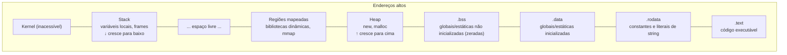

# Layout de memória de um programa

Em sistemas modernos, cada processo enxerga um **espaço de endereçamento virtual**, dividido em regiões (segmentos). Os nomes variam por sistema, mas o esquema geral é o mesmo.



## O que vai em cada região

| Região | Conteúdo | Exemplo |
|---|---|---|
| `.text` | Instruções de máquina (somente leitura + execução) | Corpos das funções |
| `.rodata` | Dados constantes | Literal `"olá"`, tabelas `constexpr` |
| `.data` | Estáticas/globais com valor inicial ≠ 0 | `int g = 5;` |
| `.bss` | Estáticas/globais zeradas | `int contador;` |
| **Heap** | Memória dinâmica | `new int`, buffer de `std::vector` |
| **Stack** | Frames de chamada: variáveis locais, endereço de retorno, parâmetros | `int x;` dentro de função |

## Observando endereços

```cpp
// g++ -std=c++20 -Wall -Wextra
#include <iostream>
#include <memory>

int global_init = 5;      // .data
int global_zero;          // .bss
const char* literal = "texto";   // o ponteiro está em .data; a string em .rodata

void funcao() {}          // .text

int main() {
    int local = 1;                          // stack
    auto heap = std::make_unique<int>(2);   // heap

    std::cout << "text:   " << reinterpret_cast<void*>(&funcao) << '\n';
    std::cout << "data:   " << &global_init << '\n';
    std::cout << "bss:    " << &global_zero << '\n';
    std::cout << "rodata: " << static_cast<const void*>(literal) << '\n';
    std::cout << "heap:   " << heap.get() << '\n';
    std::cout << "stack:  " << &local << '\n';
}
```

> [!info] ASLR
> Com *Address Space Layout Randomization*, os endereços mudam a cada execução. A **ordem relativa** (código < dados < heap < ... < stack) permanece.

> [!bug] Exemplo inválido proposital: modificar literal de string
> ```cpp
> char* s = const_cast<char*>("abc");   // aponta para .rodata
> s[0] = 'x';                           // UB: tipicamente segmentation fault
> ```
> **Correção:** `char s[] = "abc";` (cópia modificável) ou `std::string s = "abc";`.

## Por que isso importa

- Explica **por que** dados na stack morrem ao fim da função e dados no heap sobrevivem.
- Explica *segmentation faults* ao escrever em regiões somente leitura.
- Ajuda a entender tamanho de executáveis (`size ./app` mostra text/data/bss).
- É a base de ferramentas como `valgrind`, ASan e `gdb` (`info proc mappings`).

```bash
size ./app          # tamanho de text, data e bss
nm -C ./app | head  # símbolos do executável
```

## Veja também

- [[Stack vs Heap]]
- [[sizeof e alignof]]
- [[Escopo e Duração de Armazenamento]]
- [[Pipeline de Compilação - Cpp]]

## Exercício

1. Rode o programa várias vezes e observe quais endereços mudam (ASLR) e a ordem entre eles.
2. Compile com `-O2` um programa com um array global de 1 MB zerado e outro inicializado com valores. Compare `size`.
