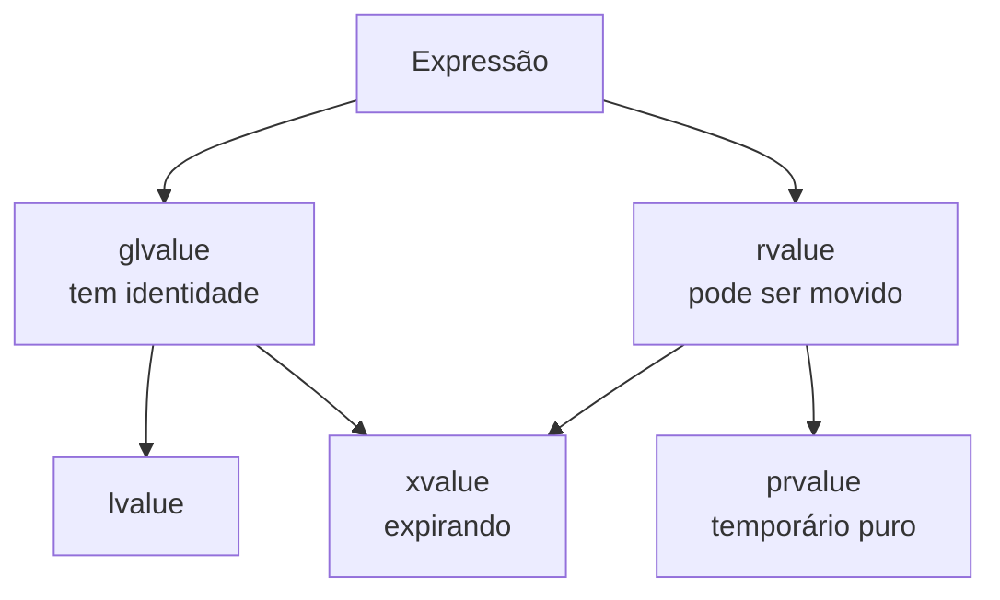

# Lvalue e rvalue

Toda **expressão** em C++ tem um **tipo** e uma **categoria de valor**. A categoria determina, entre outras coisas, se a expressão pode ser movida e a quais referências pode se ligar.

## Intuição

- **lvalue** ("*locator value*"): tem **identidade** — um nome ou endereço persistente; geralmente pode aparecer à esquerda de `=`.
- **rvalue**: valor **temporário** ou prestes a expirar, sem nome estável.

```cpp
// g++ -std=c++20 -Wall -Wextra
#include <string>

int main() {
    int x = 5;                  // x: lvalue; 5: rvalue (prvalue)
    int y = x + 1;              // x + 1: rvalue
    int* p = &x;                // &x exige lvalue
    // int* q = &(x + 1);       // erro: não se pega o endereço de um rvalue
    x = 7;                      // lvalue à esquerda

    std::string s = "abc";
    std::string t = s + "d";    // s + "d" é rvalue (string temporária)
    (void)y; (void)p; (void)t;
}
```

## As cinco categorias (C++11 em diante)



| Categoria | Exemplos | Pode mover? |
|---|---|---|
| **lvalue** | nome de variável, `*p`, `v[i]`, `a.m`, retorno `T&` | Não, a menos que seja convertido |
| **prvalue** | literais (`42`), `a + b`, `T{}`, retorno por valor `f()` | Sim |
| **xvalue** | `std::move(x)`, retorno `T&&`, `static_cast<T&&>(x)` | Sim |

## Referências e categorias

| Referência | Liga-se a |
|---|---|
| `T&` | lvalues (não-const) |
| `const T&` | lvalues **e** rvalues (estende a vida do temporário) |
| `T&&` | rvalues (prvalues e xvalues) |

```cpp
// g++ -std=c++20 -Wall -Wextra
#include <iostream>
#include <string>
#include <utility>

void f(std::string&)        { std::cout << "lvalue\n"; }
void f(const std::string&)  { std::cout << "const lvalue\n"; }
void f(std::string&&)       { std::cout << "rvalue\n"; }

int main() {
    std::string s = "oi";
    const std::string cs = "const";

    f(s);                        // lvalue
    f(cs);                       // const lvalue
    f(std::string("temp"));      // rvalue
    f(std::move(s));             // rvalue (xvalue): s ainda existe, mas está em estado "movido"
}
```

> [!warning] Um parâmetro `T&&` é um lvalue dentro da função
> Se uma função recebe `std::string&& r`, o **nome** `r` é um lvalue (tem nome). Para repassar como rvalue é preciso `std::move(r)` (ou `std::forward` em templates). Esse é o fundamento da **semântica de movimento**, aprofundada na seção de RAII e Move.

> [!danger] Usar objeto depois de `std::move`
> Após `std::move(s)` alimentar um construtor/atribuição de movimento, `s` fica em *estado válido porém não especificado*: pode ser destruído ou reatribuído, mas **não** deve ter o valor lido.

## Veja também

- [[Referências - Cpp]]
- [[Ponteiros]]
- [[Stack vs Heap]]
- [[Funções - Cpp]]

## Exercício

1. Classifique cada expressão como lvalue ou rvalue: `x`, `x + 1`, `++x`, `x++`, `"texto"`, `f()` (retorna `int`), `*p`.
2. Por que `const std::string&` aceita `f("abc")` mas `std::string&` não?
