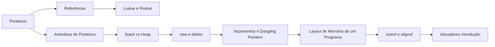

# MOC — Ponteiros e Memória

Como o C++ acessa, organiza e gerencia memória. É o terreno onde moram a maior parte dos bugs graves — e onde o C++ moderno oferece as melhores defesas.

## Ponteiros e referências

- [[Ponteiros]]
- [[Aritmética de Ponteiros]]
- [[Referências - Cpp]]
- [[Lvalue e Rvalue]]
- [[nullptr]]

## Memória dinâmica

- [[Stack vs Heap]]
- [[new e delete]]
- [[Vazamentos e Dangling Pointers]]

## Organização e layout

- [[Layout de Memória de um Programa]]
- [[sizeof e alignof]]
- [[Alocadores Introdução]]

## Conexões com outras seções

- Escopo e duração de armazenamento: [[Escopo e Duração de Armazenamento]]
- Arrays e decay: [[Arrays e std array]]
- Comportamento indefinido: [[Comportamento Indefinido e Não Especificado]]

## Ordem de leitura sugerida

## Veja também

- [[Home - Cpp]]
- [[MOC - Básico da Linguagem - Cpp]]
