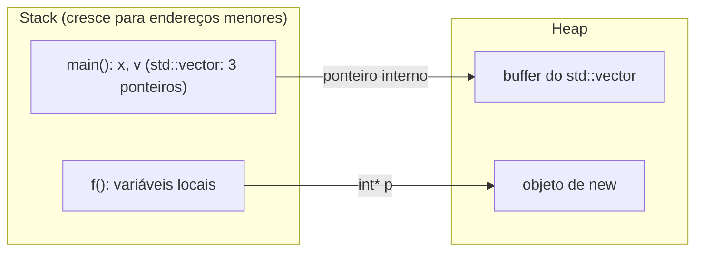

# Stack vs heap

| Aspecto | Stack (pilha) | Heap (memória dinâmica) |
|---|---|---|
| Como alocar | Variáveis locais (automáticas) | `new`, `malloc`, `std::make_unique`, contêineres |
| Liberação | **Automática** na saída do escopo | Manual (`delete`) ou por RAII |
| Velocidade | Muito rápida (mover um ponteiro) | Mais lenta (alocador procura bloco livre) |
| Tamanho típico | Pequeno (≈ 1 a 8 MB por thread) | Limitado pela RAM/memória virtual |
| Fragmentação | Não | Possível |
| Tempo de vida | Atrelado ao bloco | Arbitrário, controlado pelo programador |
| Erro típico | *Stack overflow* | Vazamento, *use-after-free*, *double free* |



## Exemplo

```cpp
// g++ -std=c++20 -Wall -Wextra
#include <iostream>
#include <memory>
#include <vector>

int main() {
    int a = 10;                              // stack
    int arr[4] = {1, 2, 3, 4};               // stack (tamanho fixo)

    std::vector<int> v(1'000'000, 7);        // objeto vector na stack, buffer de 4 MB no heap

    auto p = std::make_unique<int>(42);      // int no heap; o unique_ptr (stack) é o dono

    std::cout << a << arr[0] << v.size() << *p << '\n';
}   // saída do escopo: p libera o int; v libera o buffer; a e arr somem com o frame
```

> [!tip] Padrão em C++ moderno
> Coloque **objetos pequenos e de tempo de vida de escopo na stack**. Quando precisar de tamanho dinâmico ou tempo de vida maior, use contêineres e smart pointers: eles usam o heap **por você**, com liberação automática (RAII).

## Stack overflow

> [!danger] Arrays grandes na stack e recursão profunda
> ```cpp
> void estoura() {
>     int enorme[100'000'000];   // ~400 MB na stack: estouro (segmentation fault)
>     enorme[0] = 1;
> }
> int recursao(int n) { return recursao(n + 1); }   // sem caso base: estouro
> ```
> **Correção:** use `std::vector<int>`/`std::unique_ptr<int[]>` para dados grandes e garanta caso base em recursões (ou converta em laço).

## *Stack unwinding*

Quando uma exceção é lançada, a execução percorre a pilha de chamadas **destruindo os objetos automáticos** de cada frame. Por isso destrutores com RAII liberam recursos mesmo em erros.

## VLAs não existem em C++

`int arr[n];` com `n` variável é uma extensão do GCC/Clang (herdada do C99), **não** é C++ padrão. Use `std::vector` ou `std::array` se `n` for constante.

## Veja também

- [[Layout de Memória de um Programa]]
- [[new e delete]]
- [[Escopo e Duração de Armazenamento]]
- [[Vazamentos e Dangling Pointers]]
- [[Alocadores Introdução]]

## Exercício

1. Descubra o tamanho máximo da stack da sua máquina (`ulimit -s` no Linux) e provoque um *stack overflow* controlado.
2. Para cada variável do exemplo acima, diga onde está o **objeto** e onde estão os **dados**.
