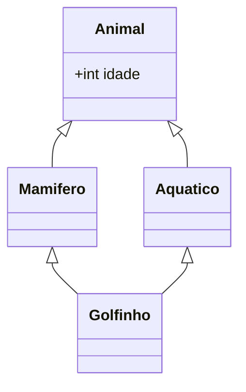

# Herança múltipla e virtual

C++ permite que uma classe herde de **várias bases**.

```cpp
// g++ -std=c++20 -Wall -Wextra
#include <iostream>

struct Voador  { virtual ~Voador() = default; void voar()  const { std::cout << "voando\n"; } };
struct Nadador { virtual ~Nadador() = default; void nadar() const { std::cout << "nadando\n"; } };

struct Pato : Voador, Nadador {};          // herda de ambas

int main() {
    Pato p;
    p.voar();
    p.nadar();
    Nadador& n = p;                        // upcast para qualquer base
    (void)n;
}
```

## Ambiguidade de nomes

Se duas bases têm o mesmo nome, a chamada sem qualificação é **ambígua**.

```cpp
// g++ -std=c++20 -Wall -Wextra
#include <iostream>

struct A { void f() const { std::cout << "A::f\n"; } };
struct B { void f() const { std::cout << "B::f\n"; } };
struct C : A, B {
    using A::f;                            // resolve a ambiguidade escolhendo A::f
};

int main() {
    C c;
    c.f();                // A::f (graças ao using)
    c.B::f();             // qualificação explícita
}
```

## O problema do diamante



Sem herança virtual, `Golfinho` contém **duas** subobjetos `Animal` (um por caminho) — `golfinho.idade` é ambíguo.

```cpp
// g++ -std=c++20 -Wall -Wextra
#include <iostream>

struct Animal {
    explicit Animal(int idade = 0) : idade(idade) {}
    int idade;
};

struct Mamifero : virtual Animal {          // herança VIRTUAL: uma única Animal compartilhada
    Mamifero() : Animal(1) {}
};
struct Aquatico : virtual Animal {
    Aquatico() : Animal(2) {}
};
struct Golfinho : Mamifero, Aquatico {
    Golfinho() : Animal(5) {}               // a classe MAIS DERIVADA inicializa a base virtual
};

int main() {
    Golfinho g;
    std::cout << g.idade << '\n';           // 5 (sem ambiguidade)
    std::cout << sizeof(Animal) << '\n';
}
```

### Regras da herança virtual

- A **classe mais derivada** inicializa a base virtual; os construtores de `Mamifero`/`Aquatico` que a nomeiam são **ignorados** nesse caso.
- Há custo extra: ponteiro adicional (para a base virtual) e acesso indireto — veja [[vtable]].
- `static_cast` de base virtual para derivada é **proibido** (use `dynamic_cast`).

## Uso saudável de herança múltipla

| Padrão | Descrição |
|---|---|
| **Múltiplas interfaces** | Herdar de várias classes abstratas sem dados (como `implements` em Java) |
| **Mixins/CRTP** | Adicionar funcionalidade por templates (seção de avançado) |
| Evitar | Herdar implementação de várias bases com estado |

```cpp
// g++ -std=c++20 -Wall -Wextra
#include <iostream>
#include <string>

struct Imprimivel { virtual ~Imprimivel() = default; virtual void imprime() const = 0; };
struct Serializavel { virtual ~Serializavel() = default; virtual std::string serializa() const = 0; };

struct Relatorio : Imprimivel, Serializavel {
    void imprime() const override { std::cout << "relatório\n"; }
    std::string serializa() const override { return "{\"tipo\":\"relatorio\"}"; }
};

int main() {
    Relatorio r;
    r.imprime();
    std::cout << r.serializa() << '\n';
}
```

> [!warning] Evite hierarquias em diamante
> Se precisar de herança virtual, é sinal para reavaliar o projeto: composição ou interfaces puras costumam resolver.

## Veja também

- [[Herança]]
- [[vtable]]
- [[Classes Abstratas e Interfaces]]
- [[Polimorfismo e Funções Virtuais]]

## Exercício

1. Remova `virtual` das bases em `Golfinho` e leia o erro de ambiguidade; depois corrija.
2. Use `sizeof(Golfinho)` com e sem herança virtual e explique a diferença.
