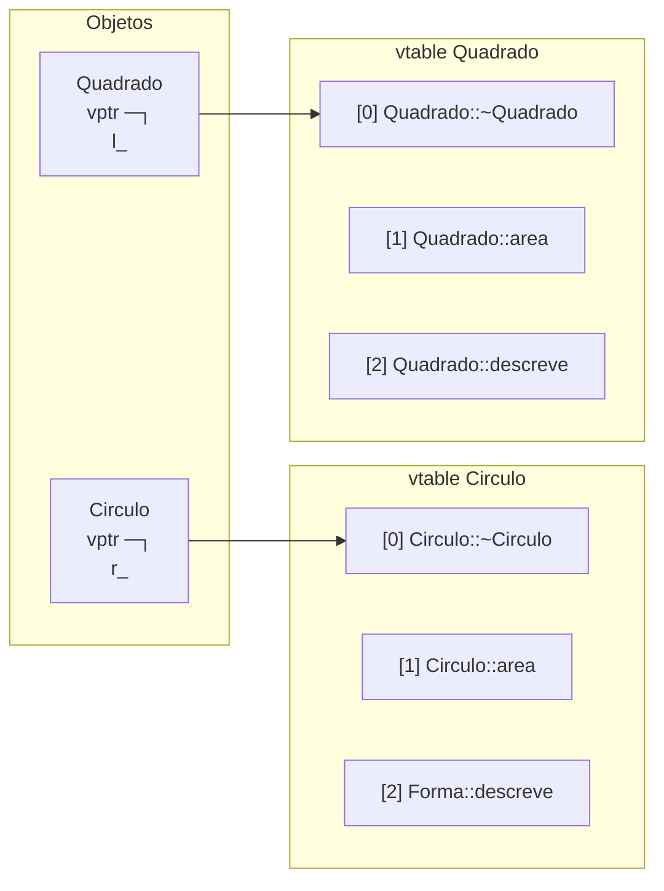

# vtable (conceitual)

> [!info] Detalhe de implementação
> O padrão C++ **não exige** vtables. Quase todos os compiladores (Itanium ABI no GCC/Clang, MSVC) as usam. O que segue é o modelo mental típico.

## Modelo

- Cada classe com funções virtuais tem uma **tabela de funções virtuais** (vtable): um array de ponteiros para as implementações **daquela classe**.
- Cada **objeto** tem um **ponteiro oculto** (`vptr`) para a vtable da sua classe **dinâmica**.
- Uma chamada `p->f()` virtual vira: ler `vptr` → indexar a vtable → chamada indireta.



## Observando o efeito

```cpp
// g++ -std=c++20 -Wall -Wextra
#include <iostream>

struct Sem  { int x; };                                   // sem virtuais
struct Com  { int x; virtual void f() {} virtual ~Com() = default; };  // com virtuais

int main() {
    std::cout << "sem virtual: " << sizeof(Sem) << '\n';  // 4
    std::cout << "com virtual: " << sizeof(Com) << '\n';  // 16 em 64 bits (vptr 8 + int 4 + padding 4)
}
```

## RTTI e `dynamic_cast`

O vptr também leva a informações de tipo (*RTTI*): `typeid(obj)` e `dynamic_cast` usam a **vtable** para descobrir o tipo dinâmico e verificar conversões (por isso exigem tipo **polimórfico**).

```cpp
// g++ -std=c++20 -Wall -Wextra
#include <iostream>
#include <typeinfo>

struct Base { virtual ~Base() = default; };
struct Derivada : Base {};

int main() {
    Derivada d;
    Base& b = d;
    std::cout << (typeid(b) == typeid(Derivada)) << '\n';   // 1: tipo dinâmico
    std::cout << (dynamic_cast<Derivada*>(&b) != nullptr) << '\n';   // 1
}
```

> [!tip] Desativando RTTI
> Em embarcados, `-fno-rtti` economiza espaço, mas desabilita `typeid` e `dynamic_cast` (e algumas bibliotecas).

## Custos e implicações

| Aspecto | Efeito |
|---|---|
| Tamanho do objeto | + 1 ponteiro (+ ponteiros para bases virtuais, se houver) |
| Chamada | Indireta; previsão de desvio e cache afetam |
| *Inlining* | Só ocorre se o compilador conseguir **desvirtualizar** (`final`, tipo conhecido) |
| Construção | O vptr é atualizado em cada nível de construtor (por isso virtuais em construtores não chegam à derivada) |
| Cópia | O vptr **não é copiado** de outro tipo: o objeto mantém o vptr do seu próprio tipo |
| ABI | Alterar a ordem/quantidade de virtuais em uma classe pública **quebra a ABI** |

> [!danger] Tratar objeto como bytes ignora o vptr
> `memcpy`/`memset` em tipos polimórficos podem sobrescrever o vptr: comportamento indefinido. Em tipos com virtuais, use construtores/atribuição.

## Herança múltipla e virtual

Com múltiplas bases polimórficas, o objeto tem **vários vptrs** (um por base com virtuais) e *thunks* ajustam `this` ao chamar. Bases **virtuais** adicionam um deslocamento guardado na vtable ([[Herança Múltipla e Virtual]]).

## Veja também

- [[Polimorfismo e Funções Virtuais]]
- [[Herança Múltipla e Virtual]]
- [[Slicing]]
- [[sizeof e alignof]]

## Exercício

1. No Compiler Explorer, compile `Forma`/`Circulo` e localize a vtable no assembly (`_ZTV...`).
2. Compare `sizeof` de uma classe com 0, 1 e 5 funções virtuais. O que muda?
