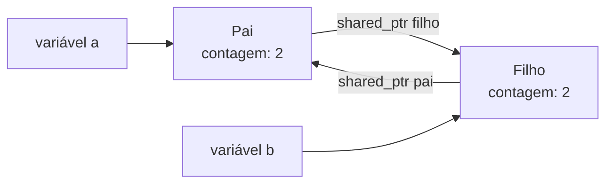

# Ciclos de referência

Quando objetos se referenciam mutuamente por `shared_ptr`, as contagens **nunca chegam a zero** e a memória **vaza**.



## O problema

```cpp
// g++ -std=c++20 -Wall -Wextra
#include <iostream>
#include <memory>

struct Filho;

struct Pai {
    std::shared_ptr<Filho> filho;
    ~Pai() { std::cout << "~Pai\n"; }
};
struct Filho {
    std::shared_ptr<Pai> pai;          // CICLO: filho mantém o pai vivo
    ~Filho() { std::cout << "~Filho\n"; }
};

int main() {
    auto p = std::make_shared<Pai>();
    auto f = std::make_shared<Filho>();
    p->filho = f;
    f->pai = p;
    std::cout << p.use_count() << ' ' << f.use_count() << '\n';   // 2 2
}   // ao sair: as variáveis morrem, mas cada objeto ainda tem contagem 1 -> NENHUM destrutor roda (vazamento)
```

(Compile com `-fsanitize=address` e o LeakSanitizer reportará o vazamento.)

## A solução: `weak_ptr` no lado "de volta"

Regra: **dono → filho forte; filho → dono fraco.**

```cpp
// g++ -std=c++20 -Wall -Wextra
#include <iostream>
#include <memory>

struct Filho;

struct Pai {
    std::shared_ptr<Filho> filho;
    ~Pai() { std::cout << "~Pai\n"; }
};
struct Filho {
    std::weak_ptr<Pai> pai;            // referência FRACA: não prolonga a vida do pai
    ~Filho() { std::cout << "~Filho\n"; }
    void usa_pai() const {
        if (auto p = pai.lock()) std::cout << "pai ainda vivo\n";
        else std::cout << "pai já foi destruído\n";
    }
};

int main() {
    auto p = std::make_shared<Pai>();
    auto f = std::make_shared<Filho>();
    p->filho = f;
    f->pai = p;
    f->usa_pai();
    std::cout << p.use_count() << ' ' << f.use_count() << '\n';   // 1 2
}   // destrói Pai (contagem 0) -> destrói o ponteiro ao filho; depois o Filho. Ambos "~" impressos
```

## Onde ciclos aparecem

| Estrutura | Direção forte | Direção fraca |
|---|---|---|
| Árvore com ponteiro ao pai | pai → filhos | filho → pai |
| Lista duplamente ligada | `proximo` | `anterior` |
| Observador/assinante | Sujeito → *nada* ou observadores fracos | Observador → sujeito (ou vice-versa, conforme posse) |
| Grafos | Defina um dono (ex.: contêiner dos nós) | Arestas como `weak_ptr` ou índices |
| Lambdas capturando `shared_ptr this` | Evite | Capture `weak_ptr` |

> [!bug] Ciclo escondido em *callbacks*
> ```cpp
> struct Conexao : std::enable_shared_from_this<Conexao> {
>     std::function<void()> cb;
>     void inicia() { cb = [self = shared_from_this()] { /*...*/ }; }   // objeto guarda lambda que guarda o objeto: ciclo
> };
> ```
> **Correção:** capturar `weak_from_this()` (C++17) e fazer `lock()` dentro do lambda.

> [!tip] Alternativas aos ciclos
> - Dono único (`unique_ptr`) + ponteiros brutos/referências para não-donos.
> - Armazenar objetos em um contêiner e referenciá-los por **índice** ou ID (comum em grafos e ECS de jogos).
> - Arena/pool que libera tudo de uma vez.

## Como detectar

- LeakSanitizer / AddressSanitizer (`-fsanitize=address`), Valgrind (`--leak-check=full`).
- Destrutores com *log* durante os testes.
- Revisão: sempre que dois tipos têm `shared_ptr` um para o outro, desenhe a **posse**.

## Veja também

- [[shared_ptr]]
- [[weak_ptr]]
- [[Vazamentos e Dangling Pointers]]
- [[RAII]]

## Exercício

1. Implemente uma árvore com `shared_ptr` para filhos e `weak_ptr` para o pai e imprima ao destruir para confirmar que todos os nós são liberados.
2. Reescreva a mesma árvore usando `std::vector<std::unique_ptr<No>>` e ponteiro bruto para o pai. Qual é mais simples?
