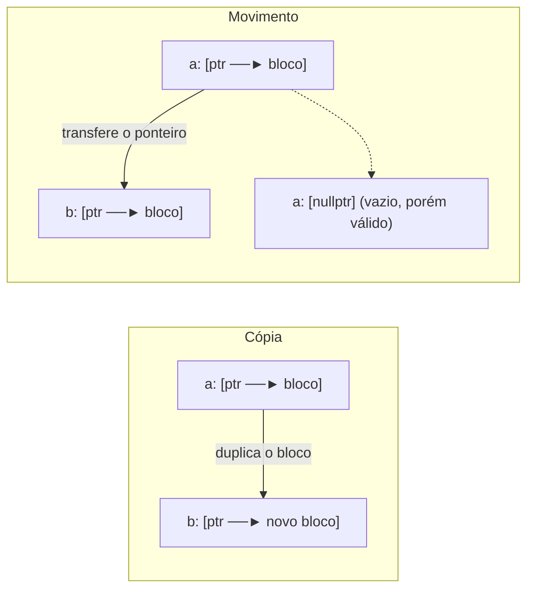

# Semântica de movimento

> [!info] Introdução
> **C++11.** Permite **transferir** recursos de um objeto que vai morrer (um rvalue) em vez de copiá-los — por exemplo, "roubar" o buffer interno de um `std::vector`.

## Ideia central



- **Cópia**: custo proporcional ao tamanho dos dados.
- **Movimento**: custo constante (copiar ponteiros/inteiros e anular a origem).

## Demonstração

```cpp
// g++ -std=c++20 -Wall -Wextra
#include <iostream>
#include <string>
#include <utility>
#include <vector>

class Anuncio {
public:
    explicit Anuncio(std::string t) : texto_(std::move(t)) {}
    Anuncio(const Anuncio& o) : texto_(o.texto_) { std::cout << "cópia\n"; }
    Anuncio(Anuncio&& o) noexcept : texto_(std::move(o.texto_)) { std::cout << "movimento\n"; }
    const std::string& texto() const { return texto_; }
private:
    std::string texto_;
};

Anuncio cria() { return Anuncio{"gerado"}; }       // prvalue: elisão garantida (C++17), sem cópia/move

int main() {
    Anuncio a{"original longo o bastante para sair do SSO e alocar no heap"};
    Anuncio b = a;                      // cópia
    Anuncio c = std::move(a);           // movimento: 'a' fica em estado válido, valor não especificado
    Anuncio d = cria();                 // nem cópia nem movimento

    std::vector<Anuncio> v;
    v.reserve(2);
    v.push_back(std::move(c));          // movimento para dentro do vetor
    v.emplace_back("construído no lugar");   // constrói direto, sem temporário
    std::cout << v.size() << ' ' << d.texto() << '\n';
}
```

## Estado "movido" (*moved-from*)

Depois de um movimento, a origem fica em **estado válido, porém não especificado**:

- Pode ser **destruída** com segurança.
- Pode receber uma **nova atribuição**.
- Operações sem pré-condições (`empty()`, `size()`, `clear()`) funcionam.
- **Não** assuma o valor (para `std::string`/`std::vector`, tipicamente vazio, mas não é garantido).

```cpp
// g++ -std=c++20 -Wall -Wextra
#include <iostream>
#include <string>
#include <utility>

int main() {
    std::string a = "hello";
    std::string b = std::move(a);
    a = "reutilizada";                       // OK: reatribuir
    std::cout << a << ' ' << b << '\n';
    // std::cout << a.front();               // sem reatribuir seria risco: pré-condição (não vazia) desconhecida
}
```

> [!danger] Usar o valor de um objeto movido
> ```cpp
> std::vector<int> v{1, 2, 3};
> auto w = std::move(v);
> std::cout << v[0];     // UB provável: v pode estar vazio
> ```
> Linters (`clang-tidy bugprone-use-after-move`) detectam isso.

## Tipos *move-only* e *copy-only*

| Categoria | Exemplos |
|---|---|
| Copiável e movível | `std::string`, `std::vector`, `int` (mover = copiar) |
| **Somente movível** | `std::unique_ptr`, `std::thread`, `std::ifstream`, `std::future` |
| Nem copiável nem movível | `std::mutex`, `std::atomic<T>` |

## Quando o movimento ocorre

- Inicializar/atribuir a partir de **rvalues** (temporários, retorno de função, `std::move(x)`).
- Contêineres realocam com **movimento** se o construtor de movimento for `noexcept` ([[noexcept e Movimento]]).
- Retornar variáveis locais **por valor** usa NRVO ou movimento automático ([[Copy Elision e RVO]]).

> [!tip] Não desabilite o movimento sem querer
> Retornar `return std::move(local);` **impede** a otimização NRVO. Escreva `return local;`.

## Veja também

- [[std move e std forward]]
- [[Lvalue e Rvalue]]
- [[noexcept e Movimento]]
- [[Copy Elision e RVO]]
- [[Regra do 0, 3 e 5]]

## Exercício

1. Meça (com `std::chrono`) mover vs copiar um `std::vector<int>` de 10 milhões de elementos.
2. Liste três tipos da biblioteca padrão que são *move-only*.
