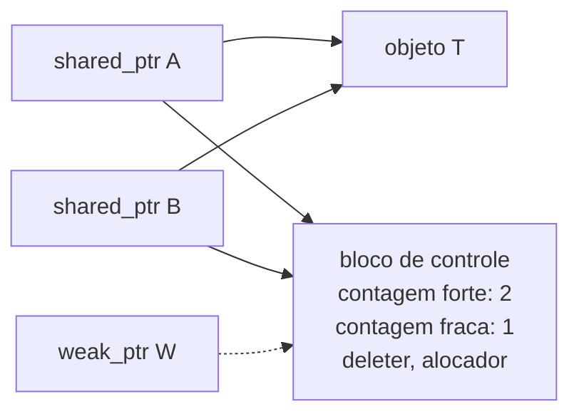

# `std::shared_ptr`

`shared_ptr<T>` implementa **posse compartilhada** por **contagem de referências**: o objeto é destruído quando o **último** `shared_ptr` que o referencia é destruído.

## Estrutura interna



Cada `shared_ptr` ocupa **dois ponteiros** (objeto + bloco de controle). A contagem é **atômica** (thread-safe para o bloco de controle, **não** para o objeto apontado).

```cpp
// g++ -std=c++20 -Wall -Wextra
#include <iostream>
#include <memory>
#include <vector>

struct Recurso {
    Recurso() { std::cout << "criado\n"; }
    ~Recurso() { std::cout << "destruído\n"; }
};

int main() {
    auto a = std::make_shared<Recurso>();
    std::cout << "contagem: " << a.use_count() << '\n';       // 1
    {
        auto b = a;                                            // cópia: compartilha
        std::vector<std::shared_ptr<Recurso>> v{a, b};
        std::cout << "contagem: " << a.use_count() << '\n';    // 4 (a, b, v[0], v[1])
    }
    std::cout << "contagem: " << a.use_count() << '\n';        // 1
}   // "destruído" ao fim: a era o último dono
```

## Quando usar

| Use `shared_ptr` quando... | Prefira `unique_ptr` quando... |
|---|---|
| Há **vários donos** reais e o tempo de vida depende do último | Há **um dono** claro |
| Objetos são compartilhados entre *threads*/callbacks com vida indeterminada | A posse pode ser **transferida**, não compartilhada |
| Grafos/caches com compartilhamento | Estruturas hierárquicas |

> [!warning] Não use `shared_ptr` "por segurança"
> Custo: alocação do bloco de controle, operações atômicas a cada cópia, posse difusa (difícil saber quando morre) e risco de [[Ciclos de Referência|ciclos]]. Comece por `unique_ptr`.

## `shared_ptr<T>` const-correctness e passagem

| Assinatura | Significado |
|---|---|
| `void f(std::shared_ptr<T> p)` | A função **compartilha** posse (incrementa a contagem) |
| `void f(const std::shared_ptr<T>& p)` | Só usa; pode copiar se precisar guardar |
| `void f(T& obj)` / `T*` | Apenas usa o objeto (preferido) |

## Armadilhas

> [!danger] Dois `shared_ptr` independentes para o mesmo ponteiro bruto
> ```cpp
> Recurso* raw = new Recurso;
> std::shared_ptr<Recurso> a(raw);
> std::shared_ptr<Recurso> b(raw);    // blocos de controle SEPARADOS: double delete (UB)
> ```
> **Correção:** copie `b = a;` ou crie com `make_shared`.

> [!bug] `shared_from_this`
> Dentro de um método, `std::shared_ptr<T>(this)` cria um **segundo** bloco de controle (UB). Herde de `std::enable_shared_from_this<T>` e use `shared_from_this()`:
> ```cpp
> struct No : std::enable_shared_from_this<No> {
>     std::shared_ptr<No> eu() { return shared_from_this(); }   // exige que o objeto já seja gerenciado por shared_ptr
> };
> ```

> [!warning] Thread-safety
> A **contagem** é atômica; a **leitura/escrita do objeto** e a **reatribuição do mesmo `shared_ptr`** a partir de várias threads precisam de sincronização (`std::atomic<std::shared_ptr<T>>` no C++20).

## Funções úteis

| Função | Uso |
|---|---|
| `use_count()` | Contagem atual (apenas para depuração) |
| `unique()` | (removido no C++20: use `use_count() == 1`) |
| `std::static_pointer_cast`, `std::dynamic_pointer_cast` | Conversões entre `shared_ptr` de classes relacionadas |
| Construtor de **aliasing** | `shared_ptr<U>(p, &p->membro)`: compartilha a posse de `p` apontando para um subobjeto |

## Veja também

- [[weak_ptr]]
- [[unique_ptr]]
- [[Ciclos de Referência]]
- [[make_unique e make_shared]]
- [[Deleters Customizados]]

## Exercício

1. Crie dois `shared_ptr` de uma mesma classe e observe a contagem ao copiar, mover e resetar.
2. Escreva uma classe `Observador` que guarde `shared_ptr<Dados>` e crie 3 observadores sobre os mesmos dados.
