# MOC — Templates e Concepts

Programação genérica em C++: escrever código uma vez e usá-lo com muitos tipos, com verificação e otimização em tempo de compilação.

## Templates essenciais

- [[Templates de Função]]
- [[Templates de Classe]]
- [[Especialização de Templates]]
- [[Parâmetros Não-Tipo]]
- [[CTAD]]
- [[Templates de Variável]]

## Pacotes e ramificação em compilação

- [[Variadic Templates e Fold Expressions]]
- [[if constexpr]]

## Restringindo e verificando tipos

- [[static_assert e Type Traits]]
- [[SFINAE e enable_if]]
- [[Concepts e requires]]

## Computação em compilação

- [[Metaprogramação em Compilação]]
- [[constexpr consteval constinit]]

## Linha do tempo dos recursos

| Padrão | Recursos |
|---|---|
| C++98 | Templates, especialização, traits |
| C++11 | `static_assert`, variadic, `constexpr`, `<type_traits>`, `decltype` |
| C++14 | Templates de variável, `_t`/`_v`, `constexpr` relaxado, lambdas genéricas |
| C++17 | `if constexpr`, fold expressions, CTAD, `auto` em NTTP |
| C++20 | **Concepts**, `consteval`, `constinit`, NTTP de classe, `auto` em parâmetros |
| C++23 | `if consteval`, `constexpr` ampliado |
| C++26 | Reflexão estática, pack indexing |

## Guia de decisão

| Quero... | Use |
|---|---|
| Restringir quais tipos um template aceita | **Concepts** |
| Escolher implementação conforme o tipo, dentro de uma função | `if constexpr` |
| Calcular algo em compilação | `constexpr` / `consteval` |
| Informação sobre um tipo | `<type_traits>` |
| Número variável de argumentos | Variadic + fold |
| Ler código antigo com `enable_if` | [[SFINAE e enable_if]] |

## Ordem de leitura sugerida

```mermaid
flowchart LR
    A[Templates de Função] --> B[Templates de Classe]
    B --> C[Especialização de Templates]
    C --> D[Parâmetros Não-Tipo]
    D --> E[Variadic Templates e Fold Expressions]
    E --> F[if constexpr]
    F --> G[static_assert e Type Traits]
    G --> H[Concepts e requires]
    H --> I[constexpr consteval constinit]
    I --> J[Metaprogramação em Compilação]
```

## Veja também

- [[Home - Cpp]]
- [[MOC - RAII e Move]]
- [[MOC - Básico da Linguagem - Cpp]]
