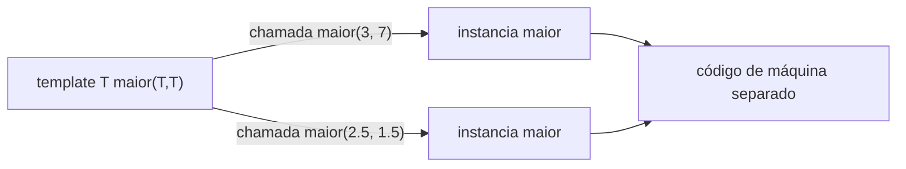

# Templates de função

Um **template** é um modelo que o compilador **instancia** com tipos (ou valores) concretos, gerando código específico para cada uso. É a base da programação genérica e da STL.

```cpp
// g++ -std=c++20 -Wall -Wextra
#include <iostream>
#include <string>

template <typename T>                         // 'class' é equivalente a 'typename' aqui
T maior(T a, T b) { return (a > b) ? a : b; }

template <typename T, typename U>
auto soma(T a, U b) { return a + b; }         // retorno deduzido (C++14)

int main() {
    std::cout << maior(3, 7) << '\n';                        // T = int (deduzido)
    std::cout << maior(2.5, 1.5) << '\n';                    // T = double
    std::cout << maior<double>(3, 2.5) << '\n';              // argumento explícito: 3 vira double
    std::cout << maior(std::string("a"), std::string("b")) << '\n';
    std::cout << soma(1, 2.5) << '\n';                       // T = int, U = double -> 3.5
    // maior(3, 2.5);                                        // erro: T deduzido como int e double (conflito)
}
```

## Como funciona



1. O compilador **deduz** `T` a partir dos argumentos (ou usa o fornecido).
2. **Instancia** a função com esse tipo — só se for usada.
3. Erros aparecem **na instanciação**: o template só é totalmente verificado quando usado.

## Dedução de argumentos: regras essenciais

| Parâmetro | Argumento | `T` deduzido |
|---|---|---|
| `T x` | `const int c` | `int` (const descartado) |
| `T& x` | `const int c` | `const int` |
| `const T& x` | `5` | `int` |
| `T&& x` (universal) | lvalue `int` | `int&` |
| `T x` | `int arr[3]` | `int*` (decay) |
| `T& x` | `int arr[3]` | `int[3]` |

> [!bug] Exemplo inválido proposital: tipos conflitantes
> ```cpp
> template <typename T> T maior(T a, T b);
> maior(1, 2.5);      // erro: deduções conflitantes (int vs double)
> ```
> **Correção:** `maior<double>(1, 2.5)`, ou dois parâmetros de tipo, ou `std::common_type_t<T, U>`.

## Parâmetros de template com valor padrão

```cpp
// g++ -std=c++20 -Wall -Wextra
#include <iostream>
#include <vector>

template <typename Container = std::vector<int>>
Container cria() { return Container{}; }

int main() {
    auto v = cria();                 // Container = std::vector<int>
    v.push_back(1);
    std::cout << v.size() << '\n';
}
```

## Sobrecarga entre templates e funções comuns

Uma função **não-template** é preferida a um template quando ambos casam igualmente bem.

```cpp
// g++ -std=c++20 -Wall -Wextra
#include <iostream>

template <typename T> void f(T) { std::cout << "template\n"; }
void f(int)                     { std::cout << "int\n"; }

int main() {
    f(1);        // int (não-template vence em empate)
    f(1.0);      // template
    f<>(1);      // força o template
}
```

## Definição em cabeçalhos

Templates precisam estar **visíveis** onde são instanciados: defina-os no **cabeçalho** (ou em `.tpp`/`.ipp` incluído por ele). Instanciações explícitas (`template void f<int>(int);`) permitem separar em `.cpp` para tipos conhecidos.

> [!warning] Inchaço de código e erros longos
> Cada instanciação gera código; mensagens de erro podem ser enormes. **Concepts** ([[Concepts e requires]]) resolvem a legibilidade dos erros.

## Veja também

- [[Templates de Classe]]
- [[Especialização de Templates]]
- [[Concepts e requires]]
- [[Variadic Templates e Fold Expressions]]
- [[auto e decltype]]

## Exercício

1. Escreva `template<typename T> T limitar(T v, T lo, T hi)` e teste com `int`, `double` e `std::string`.
2. Por que `maior("abc", "abd")` com `T` deduzido pode dar resultado inesperado? (Dica: o que é `T`?)
